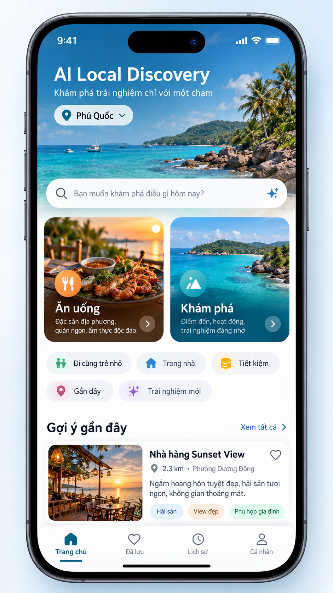
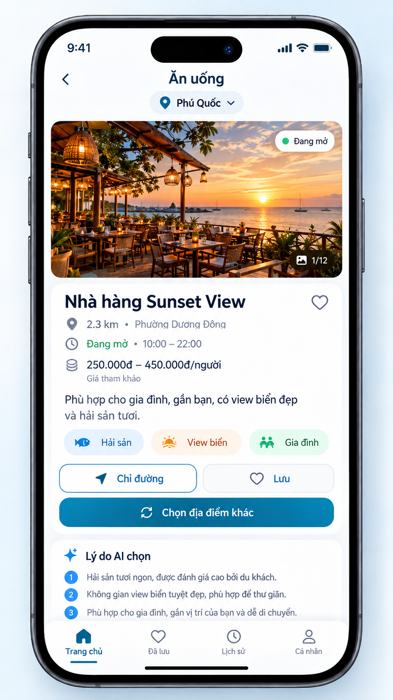
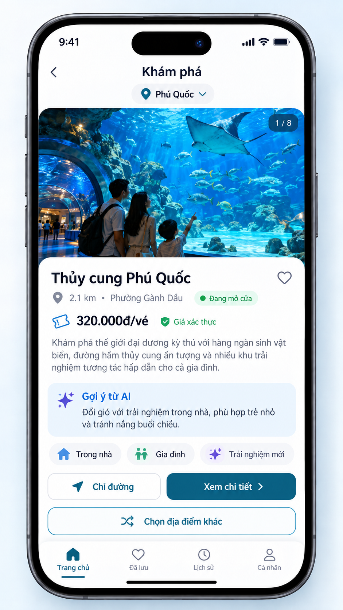
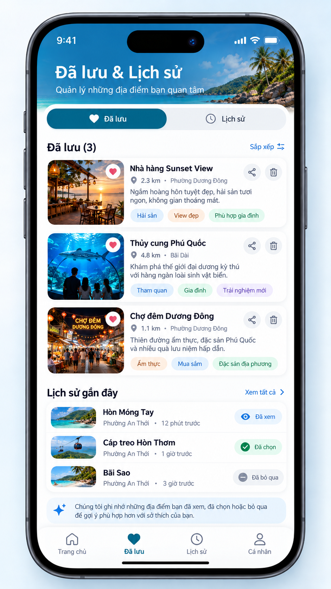

# PROJECT CONCEPT • NATIVE MOBILE APP • AI-ASSISTED DISCOVERY
# AI LOCAL DISCOVERY
### Khám phá trải nghiệm du lịch chỉ với một chạm
> **Một chạm → Một gợi ý → Một trải nghiệm mới**

| Sản phẩm chính: ứng dụng cài đặt trên Android và iOS. Người dùng có thể mở ứng dụng trực tiếp; QR tại khách sạn/resort chỉ là kênh giới thiệu tùy chọn, không phải điều kiện sử dụng. |
| :--- |

- **Đơn vị định hướng:** Khối Kinh doanh và Vận hành Du lịch – Khách sạn, VSF
- **Phiên bản:** 2.0 | **Ngày:** 29/10/2026
- **Phạm vi:** Kiểm chứng và pilot tại một điểm đến du lịch trước khi mở rộng

---

## Mục lục
1. [Tóm tắt điều hành và quyết định đề xuất](#1-tóm-tắt-điều-hành-và-quyết-định-đề-xuất)
2. [Bài toán, người dùng và giả thuyết cần kiểm chứng](#2-bài-toán-người-dùng-và-giả-thuyết-cần-kiểm-chứng)
3. [Tầm nhìn sản phẩm và lợi thế cạnh tranh](#3-tầm-nhìn-sản-phẩm-và-lợi-thế-cạnh-tranh)
4. [Trải nghiệm người dùng và luồng nghiệp vụ](#4-trải-nghiệm-người-dùng-và-luồng-nghiệp-vụ)
5. [Phạm vi chức năng P0/P1/P2](#5-phạm-vi-chức-năng-p0p1p2)
6. [Chiến lược dữ liệu và chất lượng thông tin](#6-chiến-lược-dữ-liệu-và-chất-lượng-thông-tin)
7. [Bộ máy đề xuất, xếp hạng và vai trò AI](#7-bộ-máy-đề-xuất-xếp-hạng-và-vai-trò-ai)
8. [Kiến trúc kỹ thuật cho native mobile app](#8-kiến-trúc-kỹ-thuật-cho-native-mobile-app)
9. [Giá trị kinh doanh và mô hình phát triển](#9-giá-trị-kinh-doanh-và-mô-hình-phát-triển)
10. [Chi phí dự kiến và kiểm soát ngân sách](#10-chi-phí-dự-kiến-và-kiểm-soát-ngân-sách)
11. [Bảo mật, quyền riêng tư và điều khoản dữ liệu](#11-bảo-mật-quyền-riêng-tư-và-điều-khoản-dữ-liệu)
12. [Rủi ro, phụ thuộc và biện pháp giảm thiểu](#12-rủi-ro-phụ-thuộc-và-biện-pháp-giảm-thiểu)
13. [Kế hoạch triển khai 7 tuần và phân công](#13-kế-hoạch-triển-khai-7-tuần-và-phân-công)
14. [KPI, tiêu chí nghiệm thu và quyết định Go/No-Go](#14-kpi-tiêu-chí-nghiệm-thu-và-quyết-định-gono-go)
15. [Việc cần quyết định trước khi bắt đầu](#15-việc-cần-quyết-định-trước-khi-bắt-đầu)
- [Phụ lục A. Thuật ngữ](#phụ-lục-a-thuật-ngữ)
- [Phụ lục B. Nguồn tham khảo chính thức](#phụ-lục-b-nguồn-tham-khảo-chính-thức)
- [Phụ lục C. Minh hoạ giao diện đề xuất](#phụ-lục-c-minh-hoạ-giao-diện-đề-xuất)

> **Cách đọc tài liệu:** Đây là đề xuất sản phẩm và kế hoạch pilot. Các con số KPI, thời gian và chi phí là giả định lập kế hoạch, không phải cam kết hoặc số liệu đã được VSF xác nhận.

---

## 1. Tóm tắt điều hành và quyết định đề xuất
**AI Local Discovery** là ứng dụng di động giúp khách du lịch trả lời hai câu hỏi quen thuộc: “Ăn gì?” và “Đi đâu?”. Thay vì hiển thị danh sách dài, ứng dụng chọn một địa điểm phù hợp dựa trên vị trí, thời điểm, sở thích và chất lượng dữ liệu. Người dùng có thể xem thông tin, mở chỉ đường hoặc bấm “Chọn cái khác” để nhận gợi ý mới.

| Nội dung | Đề xuất |
| :--- | :--- |
| **Định vị** | Decision helper – công cụ chọn hộ, không phải bản sao Google Maps và không bắt buộc trò chuyện với chatbot. |
| **Nền tảng** | Ứng dụng cài đặt trên Android/iOS. Đề xuất Flutter để xây một codebase đa nền tảng; QR chỉ là kênh giới thiệu tùy chọn. |
| **Người dùng đầu tiên** | Gia đình lưu trú 4–7 ngày, nhóm bạn/cặp đôi và khách tự túc tại một điểm du lịch biển. |
| **Phạm vi pilot** | Một điểm đến nơi nhóm có thể tiếp cận khách thử nghiệm, nhân sự địa phương và ít nhất một nguồn dữ liệu đáng tin cậy. |
| **Thời gian** | 7 tuần cho MVP/pilot giới hạn với nhóm 4–5 người; thời gian phát hành công khai còn phụ thuộc kiểm thử và duyệt cửa hàng ứng dụng. |
| **Nguyên tắc cốt lõi** | Một chạm; một thẻ; chọn lại không lặp; dữ liệu có nguồn; minh bạch giá; xin quyền vị trí rõ ràng. |

### Khuyến nghị đầu tư
> Nên triển khai theo mô hình “native app pilot có điều kiện”: phê duyệt giai đoạn khám phá và kiểm chứng trước; chỉ mở rộng phát triển sau khi dữ liệu, điều khoản nhà cung cấp và nhu cầu người dùng đạt ngưỡng đã thống nhất.

**Ba điều kiện cần được xác minh trước khi cam kết ra mắt:**
1. **Nhu cầu:** người dùng thực sự muốn nhận một gợi ý duy nhất thay vì danh sách và có thể chấp nhận một trong ba gợi ý đầu.
2. **Dữ liệu:** tại khu vực pilot có đủ địa điểm, ảnh được phép dùng, thông tin địa chỉ, giá hoặc đường dẫn giá và trạng thái hoạt động có thể kiểm tra.
3. **Tuân thủ:** nguồn dữ liệu, cách xếp hạng, việc dùng nội dung với LLM, quyền vị trí và chính sách lưu trữ được rà soát trước khi thử nghiệm công khai.

---

## 2. Bài toán, người dùng và giả thuyết cần kiểm chứng

### 2.1. Tình huống xuất phát
Một gia đình đi biển 7 ngày. Ba ngày đầu họ tắm biển, ăn hải sản và thăm các điểm nổi tiếng. Đến ngày thứ tư, cả nhà bắt đầu chán những hoạt động quen thuộc nhưng không muốn dành nhiều thời gian tìm kiếm và so sánh. Họ ở trong phòng dù xung quanh có thể còn nhiều trải nghiệm phù hợp.

### 2.2. Nhu cầu cốt lõi (Jobs-to-be-Done)
> Khi đang đi du lịch mà không biết nên ăn gì hoặc chơi ở đâu, tôi muốn được đề xuất ngay một lựa chọn đáng cân nhắc, phù hợp với vị trí và hoàn cảnh, để cả nhóm ra quyết định nhanh mà không phải tự nghiên cứu hàng chục kết quả.

### 2.3. Nhóm người dùng ưu tiên
| Nhóm | Nhu cầu | Hàm ý thiết kế |
| :--- | :--- | :--- |
| **Gia đình đi nghỉ dài ngày** | Tìm trải nghiệm mới, hợp nhiều độ tuổi, không lặp lại hoạt động đã chán. | Bộ lọc “đi cùng trẻ nhỏ”, “trong nhà”, “đổi loại hình”; không mặc định gia đình có trẻ em. |
| **Nhóm bạn/cặp đôi** | Muốn quyết định nhanh, có trải nghiệm địa phương và dễ chia sẻ lựa chọn. | Bookmark, chia sẻ qua ứng dụng nhắn tin, ưu tiên trải nghiệm mới. |
| **Khách lưu trú tại resort** | Muốn biết dịch vụ gần nơi ở và các hoạt động trong/ngoài khu nghỉ. | Tích hợp dữ liệu đã xác minh từ khách sạn/đối tác khi được phép. |
| **Khách tự túc** | Cần thông tin đủ tin cậy và hành động tiếp theo rõ ràng. | Nguồn dữ liệu, ngày kiểm tra, chỉ đường và liên kết chính thức. |

### 2.4. Giả thuyết cần kiểm chứng
- **H1 – Giá trị lựa chọn:** người dùng đánh giá một gợi ý có giải thích ngắn hữu ích hơn danh sách dài trong tình huống mệt mỏi vì lựa chọn.
- **H2 – Tỷ lệ chấp nhận:** trong ba gợi ý đầu, một tỷ lệ đáng kể người dùng sẽ lưu, chia sẻ, mở chỉ đường hoặc chọn địa điểm.
- **H3 – Độ tin cậy:** nguồn dữ liệu được kiểm tra giúp giảm tình trạng địa điểm đóng cửa, thiếu ảnh hoặc thiếu thông tin giá.
- **H4 – Giá trị với VSF:** trải nghiệm này có thể tăng sự hài lòng và tạo cơ hội sử dụng dịch vụ/đối tác, nhưng tác động kinh doanh phải được đo chứ không giả định.
- **H5 – Native app:** khách mục tiêu sẵn sàng cài ứng dụng nếu giá trị được giải thích rõ và việc cài đặt/đăng ký không gây ma sát quá lớn.

---

## 3. Tầm nhìn sản phẩm và lợi thế cạnh tranh

### 3.1. Nguyên tắc sản phẩm
- **One-tap first:** hai hành động chính là “Ăn uống” và “Khám phá”; không bắt người dùng điền biểu mẫu dài.
- **One-card at a time:** một gợi ý nổi bật; người dùng có thể chọn lại ngay.
- **Native-first:** cài đặt và mở ứng dụng trực tiếp, dùng GPS khi được cấp quyền, lưu tùy chọn và có thể bật thông báo nếu người dùng đồng ý.
- **Context without friction:** ngữ cảnh mặc định dựa trên thời điểm và lựa chọn hiện tại; các chip như “Đi cùng trẻ nhỏ”, “Trong nhà”, “Giá tiết kiệm”, “Gần đây” là tùy chọn.
- **No repeat by default:** không lặp địa điểm đã bị bỏ qua trong phiên khi còn ứng viên phù hợp.
- **Trust over confidence:** không bịa giá, giờ mở cửa, ảnh, số sao, vé còn chỗ hoặc sự kiện.
- **Transparent commercial ranking:** địa điểm tài trợ/ưu đãi phải được ghi nhãn; không âm thầm ưu tiên quảng cáo hơn độ phù hợp.

### 3.2. Khác biệt so với các lựa chọn hiện có
| Lựa chọn | Điểm mạnh phổ biến | Khoảng trống mà sản phẩm có thể thử giải quyết |
| :--- | :--- | :--- |
| **Google Maps** | Tìm kiếm, bản đồ, đánh giá, chỉ đường và thông tin địa điểm. | Giảm số quyết định bằng một lựa chọn có ngữ cảnh; không cố thay thế bản đồ hoặc dữ liệu của Google. |
| **Nền tảng đánh giá/ẩm thực** | Danh sách phong phú, đánh giá và nội dung cộng đồng. | Giảm công sức đọc/so sánh khi khách chỉ muốn chọn nhanh. |
| **Nền tảng đặt vé/hoạt động** | Thông tin sản phẩm, lịch và giao dịch ở các đối tác có tích hợp. | Kết nối lựa chọn địa phương với dịch vụ đáng tin; không xây hệ thống đặt vé trong MVP. |
| **Chatbot AI đa dụng** | Có thể tư vấn linh hoạt qua hội thoại. | Ít thao tác hơn, giao diện chuyên biệt, thẻ có cấu trúc và nguồn dữ liệu rõ. |
| **AI Local Discovery** | Một chạm → một lựa chọn → chọn lại. | Lợi thế dài hạn phải đến từ dữ liệu đã xác minh, hiểu bối cảnh, đối tác và chất lượng gợi ý – không chỉ từ giao diện. |

### 3.3. Lợi thế cạnh tranh cần xây dần
1. Danh sách địa điểm hạt giống đã được nhân sự địa phương/đối tác xác minh.
2. Dữ liệu giá, hoạt động và liên kết chính thức có thời điểm cập nhật rõ ràng.
3. Cơ chế tránh lặp, đa dạng loại hình và phản hồi nhanh “quá xa / quá đắt / đổi món khác”.
4. Kết nối với dịch vụ hoặc ưu đãi đối tác khi có thỏa thuận và dữ liệu xác thực.

> Không nên pitch “AI tốt hơn Google Maps”. Nên pitch “giúp khách ra quyết định nhanh hơn bằng gợi ý phù hợp, có nguồn và có thể hành động ngay”.

---

## 4. Trải nghiệm người dùng và luồng nghiệp vụ

### 4.1. Màn hình chính
| Thành phần | Hành vi |
| :--- | :--- |
| **Vị trí** | Hiện khu vực đang dùng; xin quyền vị trí khi cần. Có phương án chọn thành phố/địa điểm thủ công. |
| **Hai nút chính** | “Ăn uống” và “Khám phá” là hành động nổi bật nhất. |
| **Chip ngữ cảnh** | Tùy chọn: Đi cùng trẻ nhỏ, Trong nhà, Giá tiết kiệm, Gần đây, Trải nghiệm mới. |
| **Thẻ đề xuất** | Ảnh có quyền sử dụng; tên; lý do phù hợp; khoảng cách; địa chỉ; giờ mở cửa nếu có; giá và nguồn; thời điểm kiểm tra; hành động tiếp theo. |
| **Nút hành động** | Chọn cái khác; Chỉ đường; Lưu; Chia sẻ; Gọi điện/đặt dịch vụ khi có nguồn đáng tin. |
| **Báo thông tin sai** | Cho phép báo địa điểm đóng cửa, sai giá hoặc thông tin không đúng để đưa vào quy trình xác minh. |

### 4.2. Luồng “Ăn uống”
1. Người dùng mở app và chạm “Ăn uống”.
2. Ứng dụng lấy vị trí khi được cấp quyền; nếu không có, dùng vị trí thủ công.
3. Backend truy vấn nguồn dữ liệu được phép, lọc địa điểm không hợp lệ và lấy ứng viên.
4. Bộ máy xếp hạng theo khoảng cách, giờ, mức giá, ngữ cảnh và tính mới lạ.
5. Ứng dụng hiển thị một thẻ; người dùng có thể xem chi tiết, chỉ đường, lưu/chia sẻ hoặc chọn cái khác.
6. Nếu chọn cái khác, hệ thống tránh địa điểm đã bỏ qua và áp dụng phản hồi nhanh để đổi nhóm lựa chọn.

### 4.3. Luồng “Khám phá”
1. Người dùng chạm “Khám phá”.
2. Hệ thống tìm địa điểm/hoạt động theo vùng: bảo tàng, công viên, khu vui chơi, hoạt động trong nhà, điểm tham quan, biểu diễn hoặc trải nghiệm địa phương.
3. Ngữ cảnh thời gian và thời tiết có thể ảnh hưởng xếp hạng khi có dữ liệu đáng tin.
4. Một thẻ đề xuất được hiển thị; giá vé và lịch hoạt động phải có nguồn chính thức hoặc nhãn chưa xác minh.
5. Người dùng chọn lại, lưu, chia sẻ hoặc mở liên kết chính thức.

### 4.4. Trải nghiệm khi chọn lại
| Phản hồi nhanh | Cách xử lý |
| :--- | :--- |
| **Quá xa** | Giảm bán kính hoặc tăng trọng số khoảng cách. |
| **Quá đắt** | Ưu tiên mức giá thấp hơn; không tự suy đoán giá nếu thiếu dữ liệu. |
| **Đổi món/loại hình** | Tăng độ đa dạng và loại bớt nhóm vừa xem. |
| **Không phù hợp trẻ nhỏ** | Chỉ áp dụng khi người dùng chọn ngữ cảnh này; loại các địa điểm không đáp ứng dữ liệu tối thiểu. |
| **Đã đến rồi** | Không lặp trong phiên; có thể lưu trạng thái “đã ghé” nếu người dùng chủ động xác nhận. |

### 4.5. Cài đặt và phân phối native app
- Ứng dụng có thể được tìm và cài từ Google Play/App Store hoặc phân phối qua liên kết chính thức.
- QR tại lễ tân/phòng nghỉ là một kênh bổ sung giúp khách truy cập trang tải app hoặc mở deep link; không phải điều kiện để dùng.
- Không yêu cầu đăng ký tài khoản trước khi xem gợi ý cơ bản nếu không cần thiết.
- MVP có thể dùng Flutter để phát triển app cài đặt cho Android/iOS từ một codebase. Nếu VSF yêu cầu code native thuần Swift/Kotlin, cần điều chỉnh ngân sách và tiến độ.

> **Lưu ý lịch phát hành:** 7 tuần có thể đủ cho bản pilot nội bộ/testflight hoặc Google Play internal testing. Phát hành công khai phụ thuộc quy trình tài khoản nhà phát triển, kiểm thử và duyệt cửa hàng ứng dụng.

---

## 5. Phạm vi chức năng P0/P1/P2

| Ưu tiên | Chức năng | Tiêu chí tối thiểu |
| :--- | :--- | :--- |
| **P0** | Native app Android/iOS | Cài đặt được trên thiết bị thử nghiệm; giao diện responsive; xử lý loading/error. |
| **P0** | Vị trí và fallback | GPS khi được phép; chọn vị trí thủ công khi từ chối; chỉ xin quyền khi cần. |
| **P0** | Ăn uống / Khám phá | Một chạm tạo một gợi ý có cấu trúc. |
| **P0** | Thẻ địa điểm | Tên, địa chỉ, ảnh nếu được phép, mô tả/lý do có nguồn, khoảng cách, giá hoặc trạng thái chưa có giá. |
| **P0** | Chọn cái khác | Không lặp địa điểm đã bỏ qua trong phiên khi còn ứng viên hợp lệ. |
| **P0** | Nguồn và độ tin cậy | Hiển thị nguồn hoặc liên kết; thời điểm kiểm tra; phân biệt giá xác thực/tham khảo/chưa có. |
| **P0** | Chỉ đường | Mở ứng dụng bản đồ qua URL/deep link; không tự xây bản đồ dẫn đường. |
| **P0** | Dữ liệu hạt giống | Danh sách địa điểm pilot được xác minh; quy trình cập nhật và báo lỗi. |
| **P0** | Bảo mật cơ bản | API key không đặt trong app; logging tối thiểu; thông báo và đồng ý quyền vị trí. |
| **P0** | Đo lường | Ghi lượt gợi ý, đổi gợi ý, lưu/chia sẻ/chỉ đường và lỗi; tránh lưu tọa độ chính xác nếu không cần. |
| **P1** | Ngữ cảnh nhanh | Trẻ nhỏ, trong nhà/ngoài trời, ngân sách, bán kính, trải nghiệm mới. |
| **P1** | Bookmark/chia sẻ | Lưu địa điểm và chia sẻ thẻ/liên kết với người đi cùng. |
| **P1** | Thời tiết và giờ | Dùng nguồn có giấy phép/điều khoản rõ ràng; chỉ ảnh hưởng xếp hạng khi dữ liệu có sẵn. |
| **P1** | Cá nhân hóa nhẹ | Nhớ sở thích và nơi đã bỏ qua theo lựa chọn rõ ràng; cho phép xóa. |
| **P2** | Đối tác/ưu đãi | Liên kết đặt bàn, mua vé hoặc ưu đãi có thỏa thuận và nhãn minh bạch. |
| **P2** | Sự kiện và vé | Tích hợp lịch diễn, giá và tồn vé từ nguồn chính thức/đối tác. |
| **P2** | Dashboard đối tác | Quản lý dữ liệu, giá, giờ và ưu đãi; có lịch sử chỉnh sửa. |

### Ngoài phạm vi MVP
- Thanh toán nội bộ, đặt phòng, xây dựng hệ thống đặt vé hoàn chỉnh.
- Chatbot đa lượt bắt buộc hoặc agent tự động thao tác đặt dịch vụ.
- Phủ dữ liệu toàn Việt Nam ngay từ đầu.
- Cam kết mọi giá, giờ mở cửa và tồn vé đúng tuyệt đối theo thời gian thực.
- Theo dõi vị trí nền liên tục hoặc tự xác nhận khách đã ghé địa điểm chỉ dựa trên GPS.

---

## 6. Chiến lược dữ liệu và chất lượng thông tin

### 6.1. Chiến lược nguồn dữ liệu
| Loại dữ liệu | Nguồn ưu tiên | Điều kiện |
| :--- | :--- | :--- |
| **Địa điểm pilot** | Danh sách do VSF/đối tác/nhân sự địa phương xác minh. | Có người chịu trách nhiệm cập nhật; ghi nguồn và thời điểm xác minh. |
| **Địa chỉ/tọa độ/loại hình** | Nguồn được cấp phép, API địa điểm phù hợp hoặc dữ liệu do đối tác cung cấp. | Rà soát điều khoản sử dụng, giới hạn lưu trữ, hiển thị và ghi nguồn. |
| **Ảnh** | Ảnh do đối tác cung cấp có quyền sử dụng; hoặc ảnh từ nhà cung cấp theo điều khoản. | Không tải/copy ảnh tùy ý; đáp ứng yêu cầu ghi công. |
| **Giá nhà hàng** | Menu/website chính thức, đối tác, mức giá từ nguồn có giấy phép. | Phân biệt giá chính thức, giá tham khảo và không có dữ liệu. |
| **Giá vé/lịch diễn** | Website chính thức hoặc API đối tác. | Không để AI tự tạo giá, suất diễn hoặc tình trạng vé. |
| **Giờ mở cửa** | Nguồn chính thức/đối tác hoặc API được phép. | Ghi thời điểm truy vấn/kiểm tra; không bảo đảm tình trạng tại hiện trường. |
| **Thời tiết** | Nhà cung cấp thời tiết có điều khoản rõ ràng. | Chỉ dùng như tín hiệu xếp hạng; không biến dự báo thành sự thật chắc chắn. |

### 6.2. Danh sách kiểm duyệt hạt giống (Curated Seed List)
Trong giai đoạn pilot, không nên phụ thuộc hoàn toàn vào kết quả thô từ một API. Đề xuất xây danh sách 100–200 địa điểm tại khu vực thử nghiệm, được nhân sự địa phương hoặc đối tác kiểm tra trước khi đưa vào nhóm gợi ý ưu tiên.
- **Trường bắt buộc:** mã nội bộ, tên, loại hình, địa chỉ, tọa độ, nguồn, trạng thái xác minh, thời điểm xác minh và liên kết chính thức nếu có.
- **Trường tùy chọn:** ảnh và quyền sử dụng ảnh, khoảng giá, giờ mở cửa, phù hợp trẻ em, trong nhà/ngoài trời, thời lượng trải nghiệm, ghi chú chất lượng.
- Không có giá hoặc ảnh không có nghĩa là loại bỏ ngay; cần hiển thị minh bạch và chỉ đưa vào gợi ý nếu vẫn đủ thông tin để quyết định.
- Có quy trình báo sai, xác minh lại và đánh dấu tạm ngừng/đóng cửa.

### 6.3. Audit dữ liệu tuần 1
| Chỉ số kiểm tra | Mục tiêu ban đầu cho pilot | Ghi chú |
| :--- | :--- | :--- |
| Bản ghi có tên, địa chỉ/tọa độ, loại hình, nguồn và ngày kiểm tra | 100% tập địa điểm được dùng trong pilot | Không dùng bản ghi không có nguồn truy vết. |
| Địa điểm có ảnh được phép sử dụng | ≥80% mục tiêu | Nếu thấp hơn, thiết kế thẻ không phụ thuộc ảnh. |
| Địa điểm có giá tham khảo hoặc link giá chính thức | ≥70% mục tiêu | Ngưỡng thử nghiệm; có thể điều chỉnh theo loại hình. |
| Trạng thái đang hoạt động được xác minh | 100% nhóm gợi ý nổi bật | Cần quy trình cập nhật khi báo sai. |
| Tỷ lệ bản ghi có dữ liệu không nhất quán | Đo baseline trước khi chốt | Không giả định chất lượng dữ liệu từ trước. |

### 6.4. “Thời gian thực” cần được diễn đạt đúng
> **Cam kết đề xuất:** “Ứng dụng truy vấn thông tin mới nhất hiện có từ các nguồn tích hợp, hiển thị nguồn và thời điểm kiểm tra, đồng thời công khai trường nào chỉ mang tính tham khảo.” Không cam kết mọi dữ liệu đúng 100% theo thời gian thực.

Tìm dữ liệu trực tuyến không đồng nghĩa với xác minh được tình trạng thực tế tại hiện trường. Nhà hàng có thể đóng cửa đột xuất; giá vé có thể đổi; ảnh có thể cũ. Mỗi trường dữ liệu cần có nguồn và quy tắc cập nhật riêng.

---

## 7. Bộ máy đề xuất, xếp hạng và vai trò AI

### 7.1. Nguyên tắc kiến trúc AI
- Tách tìm kiếm, lọc và xếp hạng khỏi việc viết lời giải thích.
- Bộ máy xếp hạng chọn địa điểm từ dữ liệu có cấu trúc; LLM chỉ giải thích ngắn vì sao lựa chọn có thể phù hợp.
- Nếu không dùng được LLM hoặc chi phí/độ trễ cao, dùng template để tạo câu giải thích từ trường dữ liệu đã xác minh.
- Không gửi nội dung từ nhà cung cấp bên thứ ba sang LLM nếu điều khoản chưa cho phép; cần rà soát chính sách của cả nguồn dữ liệu và nhà cung cấp mô hình.
- AI không được tự tạo địa điểm, giá, giờ, rating, số vé còn lại hoặc sự kiện.

### 7.2. Bộ lọc cứng trước khi xếp hạng
1. Loại địa điểm bị đánh dấu đóng cửa hoặc không đủ dữ liệu tối thiểu.
2. Áp dụng loại hình được người dùng chọn: ăn uống hoặc khám phá.
3. Áp dụng giới hạn khoảng cách/ngân sách/ngữ cảnh nếu người dùng chọn.
4. Loại địa điểm đã bỏ qua trong phiên, trừ khi hết ứng viên phù hợp.
5. Chỉ sau đó mới chấm điểm các ứng viên còn lại.

### 7.3. Công thức xếp hạng khởi điểm
> **Điểm tổng** = 25% phù hợp loại hình + 20% khoảng cách/thời gian di chuyển + 20% phù hợp ngữ cảnh + 15% phù hợp ngân sách + 10% độ tin cậy/tươi mới của dữ liệu + 10% tính mới lạ/đa dạng.

- Không để rating/popularity chi phối toàn bộ kết quả; có thể đặt trần cho tín hiệu phổ biến.
- Độ tin cậy dữ liệu là tín hiệu quan trọng: địa điểm có nguồn rõ ràng nên được ưu tiên hơn nơi thiếu dữ liệu trọng yếu.
- Tính mới lạ có nghĩa là thay đổi loại hình/nhóm trải nghiệm, không chỉ chọn địa điểm khác cùng loại.

### 7.4. Xử lý cold-start
- Cold-start là tình huống hệ thống chưa biết sở thích người dùng. Không nên bắt người dùng trả lời nhiều câu hỏi trước khi nhận gợi ý.
- Mặc định dùng loại hình đã chọn, thời điểm trong ngày, khoảng cách hợp lý và dữ liệu chất lượng.
- Không tự suy đoán người dùng đi với trẻ nhỏ, có ngân sách thấp hoặc thích hoạt động trong nhà.
- Hiển thị chip lọc tùy chọn ngay trên màn hình chính.
- Sau lần bỏ qua, hỏi phản hồi một chạm không bắt buộc để tránh gợi ý cùng kiểu.

### 7.5. Cơ chế “Chọn cái khác” và chi phí
Một phiên có thể duy trì tập ứng viên/ID cần thiết để tránh lặp và xếp hạng lại theo phản hồi, nhưng chỉ được lưu nội dung của nhà cung cấp trong phạm vi điều khoản cho phép. Không mặc định lưu cache dữ liệu Places hoặc ảnh vô thời hạn. Khi hết ứng viên hoặc cần dữ liệu mới, hệ thống truy vấn lại theo chính sách và ngân sách.

---

## 8. Kiến trúc kỹ thuật cho native mobile app

### 8.1. Kiến trúc đề xuất
| Lớp | Trách nhiệm | Công nghệ gợi ý |
| :--- | :--- | :--- |
| **Mobile app** | Android/iOS; quyền vị trí; hai chế độ; thẻ gợi ý; chip lọc; bookmark/share; deep link chỉ đường; báo lỗi. | Flutter; build Android và iOS. |
| **Backend API** | Xác thực nếu cần, quản lý phiên, gọi nguồn dữ liệu, rate limit, bảo vệ API key, trả dữ liệu chuẩn hóa. | FastAPI hoặc NestJS. |
| **Provider adapters** | Kết nối từng nhà cung cấp và chuẩn hóa dữ liệu theo hợp đồng/điều khoản. | Module riêng cho từng provider; tránh khóa chặt vào một nguồn. |
| **Data curation** | Danh sách hạt giống, nguồn, ngày xác minh, trạng thái và lịch sử cập nhật. | PostgreSQL/admin tool đơn giản. |
| **Ranking service** | Lọc cứng, chấm điểm, chống lặp, áp dụng phản hồi và chọn một địa điểm. | Quy tắc kiểm thử được; chưa cần agent đa bước. |
| **AI explanation** | Tạo lý do phù hợp từ trường đã xác minh; template dự phòng. | LLM được phê duyệt sau rà soát điều khoản; có thể tắt ở MVP. |
| **Analytics/monitoring** | Đo phễu sử dụng, lỗi, thời gian phản hồi, chi phí và crash. | Công cụ phân tích phù hợp chính sách dữ liệu. |

### 8.2. Luồng dữ liệu
1. Người dùng chạm “Ăn uống” hoặc “Khám phá”; app xin vị trí khi cần và được người dùng cho phép.
2. App gửi truy vấn tối thiểu đến backend; không nhúng API key nhạy cảm trong ứng dụng.
3. Backend lấy ứng viên từ dữ liệu được cấp phép và danh sách đã xác minh.
4. Hệ thống lọc, xếp hạng và chọn một địa điểm; ghi rõ trường nào có nguồn và trường nào chưa có.
5. Nếu được phép và có ích, LLM tạo lời giải thích ngắn; nếu không, dùng template.
6. App hiển thị thẻ; hành động chỉ đường mở ứng dụng bản đồ ngoài qua liên kết phù hợp.
7. Analytics chỉ thu thập dữ liệu cần thiết; không lưu tọa độ chính xác trong log nếu không có mục đích và căn cứ rõ.

### 8.3. Yêu cầu kỹ thuật tối thiểu
- API key được giữ ở backend; cấu hình hạn mức và cảnh báo chi phí.
- Có timeout, retry có giới hạn, trạng thái lỗi và fallback khi nguồn dữ liệu/LLM không phản hồi.
- Bảo vệ endpoint khỏi spam; giới hạn số lần tìm kiếm mỗi phiên/người dùng.
- Có kiểm thử thiếu ảnh, thiếu giá, sai tọa độ, GPS bị từ chối, mạng yếu và không có kết quả.
- Dữ liệu người dùng có thể xóa; lịch sử và sở thích không được lưu lâu hơn nhu cầu đã công bố.
- Không yêu cầu chạy GPS nền cho chức năng cốt lõi.

---

## 9. Giá trị kinh doanh và mô hình phát triển

### 9.1. Giá trị theo đối tượng
| Đối tượng | Giá trị kỳ vọng | Cách kiểm chứng |
| :--- | :--- | :--- |
| **Khách du lịch** | Giảm thời gian chọn lựa, khám phá loại hình mới, thông tin rõ ràng. | Thời gian đến gợi ý; chấp nhận trong ba gợi ý; khảo sát hài lòng. |
| **Khách sạn/resort** | Cải thiện trải nghiệm lưu trú, giúp khách biết thêm dịch vụ và địa điểm xung quanh. | Tỷ lệ sử dụng app; lượt mở liên kết dịch vụ; phản hồi khách. |
| **Nhà hàng/điểm vui chơi** | Tiếp cận khách có nhu cầu ngay tại điểm đến. | Lượt mở liên hệ/đường đi/đặt dịch vụ từ gợi ý. |
| **VSF** | Có thể tạo một lớp khám phá dịch vụ; mở cơ hội hợp tác và đo chuyển đổi. | Pilot có nhóm so sánh nếu khả thi; doanh thu/chuyển đổi chỉ tính khi có dữ liệu đáng tin. |

### 9.2. Mô hình phát triển thương mại
- **Giai đoạn đầu:** ứng dụng miễn phí cho khách, tập trung xác nhận trải nghiệm và độ tin cậy.
- **Giai đoạn sau:** liên kết đối tác, đặt bàn/mua vé qua link hoặc API có thỏa thuận.
- Có thể thử ưu đãi/địa điểm tài trợ, nhưng phải ghi nhãn rõ ràng và không làm sai lệch mục tiêu phù hợp.
- Chỉ tính doanh thu/hoa hồng khi có tracking và dữ liệu chuyển đổi được đối tác xác nhận.

### 9.3. Cách chọn địa điểm pilot
Chưa nên chốt Phú Quốc hay Nha Trang chỉ dựa trên cảm tính hoặc thời tiết chung. Chọn khu vực theo khả năng tiếp cận dữ liệu và người dùng:
1. Có ít nhất một khách sạn/resort/đối tác sẵn sàng hỗ trợ tuyển người thử nghiệm.
2. Có nhân sự địa phương hoặc concierge có thể xác minh 100–200 địa điểm hạt giống.
3. Có đủ loại hình trong nhà/ngoài trời và nhiều mức giá để thử khả năng đa dạng hóa.
4. Có thể tiếp cận khách trong thời gian pilot và xin phép thu thập phản hồi.

> **Khuyến nghị:** chọn nơi có đối tác vận hành thật và khả năng kiểm chứng dữ liệu tốt nhất, không nhất thiết là nơi có nhiều địa điểm nhất.

---

## 10. Chi phí dự kiến và kiểm soát ngân sách

### 10.1. Các nhóm chi phí
- **API dữ liệu địa điểm:** tìm kiếm, chi tiết, ảnh và các trường dữ liệu bổ sung.
- **AI/LLM:** tạo lý do đề xuất; có thể giảm mạnh bằng template hoặc tắt trong giai đoạn kiểm chứng.
- **Backend/database/monitoring:** tùy nhà cung cấp, lưu lượng và chính sách lưu dữ liệu.
- **Tài khoản nhà phát triển và phân phối app:** Google Play, Apple Developer, ký ứng dụng, kiểm thử thiết bị.
- **Vận hành dữ liệu:** thời gian của nhân sự/đối tác xác minh địa điểm, cập nhật giá và xử lý báo sai.
- **Pháp chế/bảo mật/kiểm thử:** xác nhận điều khoản API, quyền riêng tư và quy trình dữ liệu.

### 10.2. Ví dụ minh họa Google Places API
Bảng giá chính thức Google Maps Platform được kiểm tra ngày 29/10/2026 liệt kê Nearby Search Pro: 5.000 lượt miễn phí/tháng, sau đó $32/1.000 lượt; Nearby Search Enterprise: 1.000 lượt miễn phí/tháng, sau đó $35/1.000 lượt; Place Details Photos: 1.000 lượt miễn phí/tháng, sau đó $7/1.000 lượt. Giá thực tế phụ thuộc SKU, trường dữ liệu, khu vực tài khoản, các dịch vụ phát sinh và thay đổi bảng giá.

| Kịch bản giả định | Phép tính | Chi phí |
| :--- | :--- | :--- |
| 6.000 Nearby Search Enterprise | (6.000 − 1.000) × $35 / 1.000 | $175 |
| 18.000 lượt Place Details Photos | (18.000 − 1.000) × $7 / 1.000 | $119 |
| **Tổng hai dòng** | Chưa tính Place Details Enterprise, AI, hạ tầng, thuế hoặc dịch vụ khác. | **$294/tháng** |

> Kịch bản $294 giả định 6.000 lượt tìm kiếm Enterprise và trung bình 3 thẻ/phiên với tổng 18.000 request ảnh. Nếu mỗi thẻ còn gọi Place Details Enterprise riêng, chi phí sẽ tăng thêm. Đây là phép tính minh họa, không phải dự toán hóa đơn đầy đủ.

### 10.3. Kiểm soát chi phí
- Chỉ yêu cầu trường dữ liệu thực sự cần thiết; kiểm tra SKU do FieldMask kích hoạt.
- Đặt quota, rate limit, cảnh báo ngân sách và dashboard chi phí.
- Không gọi lại Nearby Search cho mỗi lần “Chọn cái khác” nếu còn ứng viên hợp lệ và việc sử dụng dữ liệu trong phiên được phép.
- Không lưu cache nội dung/ảnh trái điều khoản; thiết kế cơ chế phiên phù hợp chính sách của nhà cung cấp.
- Đo chi phí trên mỗi phiên và mỗi hành động hữu ích; không tối ưu chỉ theo số request.
- Giữ LLM ở mức tùy chọn, dùng template fallback và kiểm tra chi phí theo token.

---

## 11. Bảo mật, quyền riêng tư và điều khoản dữ liệu

### 11.1. Quyền vị trí và dữ liệu cá nhân
- Giải thích ngắn gọn vì sao cần vị trí và chỉ xin quyền khi người dùng thực hiện hành động cần định vị.
- Cho phép chọn vị trí thủ công khi người dùng từ chối GPS.
- Chỉ xử lý vị trí ở mức cần thiết; tránh lưu tọa độ chính xác vào log/analytics nếu không có nhu cầu được xác định.
- Công khai dữ liệu nào được gửi tới backend, nhà cung cấp bản đồ và nhà cung cấp AI; nêu mục đích, thời gian lưu và cách yêu cầu xóa.
- Cho phép người dùng xóa lịch sử/sở thích đã lưu; không bật theo dõi GPS nền cho MVP.
- Nhờ bộ phận pháp chế/bảo mật xác nhận nghĩa vụ áp dụng trước pilot. Cơ sở pháp lý cần được rà soát tối thiểu gồm Luật Bảo vệ dữ liệu cá nhân số 91/2025/QH15 và Nghị định 356/2025/NĐ-CP.

### 11.2. Điều khoản nhà cung cấp dữ liệu
- Không mặc định rằng dữ liệu Places hoặc ảnh có thể lưu trữ, sao chép, tái phân phối hoặc chuyển sang LLM tùy ý.
- Rà soát yêu cầu ghi nguồn, logo, cách hiển thị trên bản đồ và giới hạn lưu trữ của từng nguồn.
- Google nêu rằng nội dung Places không được pre-fetch/cache/store ngoài các ngoại lệ cho phép; `place_id` được miễn hạn chế caching nhất định. Khi hiển thị nội dung Places không kèm Google Map, có yêu cầu ghi logo/attribution.
- Thiết kế provider adapter để có thể đổi nhà cung cấp nếu chi phí, độ phủ, điều khoản hoặc chất lượng không phù hợp.

### 11.3. Checklist trước pilot công khai
- [ ] Có chính sách quyền riêng tư và điều khoản sử dụng phù hợp.
- [ ] Có màn hình đồng ý/quyền vị trí rõ ràng và đường đi khi từ chối.
- [ ] Đã rà soát cách sử dụng, hiển thị, lưu trữ và ghi nguồn nội dung từng nhà cung cấp.
- [ ] Đã xác nhận việc chuyển dữ liệu địa điểm sang LLM được phép hoặc đã thiết kế để không chuyển dữ liệu bị hạn chế.
- [ ] API key không lộ trong ứng dụng; có quota, rate limit và cảnh báo.
- [ ] Có quy trình tiếp nhận và sửa thông tin sai; có người chịu trách nhiệm.
- [ ] Có quy trình xóa dữ liệu cá nhân và giới hạn thời gian lưu.

---

## 12. Rủi ro, phụ thuộc và biện pháp giảm thiểu

| Rủi ro | Mức | Biện pháp giảm thiểu |
| :--- | :--- | :--- |
| **Khách không muốn cài thêm app** | Cao | Prototype trước; onboarding không bắt đăng ký; giải thích lợi ích ngay; liên kết cửa hàng app/deep link; QR chỉ là kênh bổ sung. |
| **Dữ liệu địa điểm thiếu/cũ** | Cao | Audit 100–200 địa điểm; seed list có kiểm duyệt; ngày xác minh; nút báo sai; quy trình cập nhật. |
| **Giá/giờ/sự kiện sai** | Cao | Nguồn chính thức/đối tác; nhãn giá; không bịa; trạng thái “chưa có dữ liệu”; không hứa realtime tuyệt đối. |
| **Rủi ro điều khoản Google/nhà cung cấp** | Cao | Rà soát pháp chế/kỹ thuật trước khi chốt; dùng dữ liệu có giấy phép; tách provider adapter. |
| **LLM tạo thông tin không có nguồn** | Cao | Tách ranking và generation; đầu ra giới hạn; template fallback; kiểm thử regression. |
| **Chi phí tăng do nhiều thẻ/ảnh** | Trung bình-cao | Theo dõi SKU; FieldMask tối thiểu; quota; đo cost/session; tối ưu luồng đổi gợi ý trong phạm vi được phép. |
| **Gợi ý quá giống nhau** | Trung bình | Diversity penalty; phản hồi nhanh; loại nơi đã bỏ qua; giới hạn ảnh hưởng của popularity. |
| **Lo ngại quyền riêng tư** | Cao | Xin phép đúng lúc; chọn vị trí thủ công; tối thiểu hóa log; chính sách xóa và minh bạch bên thứ ba. |
| **Trễ duyệt App Store/Google Play** | Trung bình | Chuẩn bị tài khoản sớm; dùng internal testing/TestFlight cho pilot; không lấy public release làm cam kết chắc chắn tuần 7. |
| **Không chứng minh được giá trị kinh doanh** | Cao | Định nghĩa KPI trước; thử nghiệm có phản hồi; ưu tiên đối tác thật; không tuyên bố tăng doanh thu khi chưa đo. |

---

## 13. Kế hoạch triển khai 7 tuần và phân công

### 13.1. Roadmap
| Tuần | Công việc | Đầu ra / cổng quyết định |
| :--- | :--- | :--- |
| **1 – Discovery & audit** | Phỏng vấn 15–25 người; prototype bấm thử; audit 100–200 địa điểm; rà điều khoản nguồn dữ liệu; chốt khu vực. | Báo cáo nhu cầu, độ phủ dữ liệu, phương án nguồn và quyết định Go/No-Go trước khi xây sâu. |
| **2 – UX & nền tảng** | Thiết kế UI; tạo app Flutter; backend skeleton; quyền vị trí; vị trí thủ công; cấu hình môi trường. | App chạy trên thiết bị thử nghiệm với dữ liệu mẫu. |
| **3 – Data integration** | Tích hợp nguồn được phê duyệt; provider adapter; thẻ địa điểm; ảnh, địa chỉ, link chính thức. | Có kết quả thật từ nguồn hợp lệ tại khu vực pilot. |
| **4 – Ranking & choose again** | Bộ lọc cứng, xếp hạng, không lặp, chip phản hồi, fallback khi hết ứng viên. | Chọn lại được nhiều lần; không lặp khi còn ứng viên; đo request/cost. |
| **5 – Trust & AI** | Nhãn giá, nguồn và ngày kiểm tra; lý do đề xuất bằng template/LLM được phê duyệt; bookmark/share nếu đủ nguồn lực. | Bộ kiểm thử không có lỗi bịa dữ kiện trọng yếu. |
| **6 – QA & privacy** | Kiểm thử GPS, mạng yếu, lỗi API, thiếu dữ liệu, thiết bị; rà quyền riêng tư và bảo mật. | Danh sách lỗi ưu tiên cao đã xử lý; checklist pháp lý sẵn sàng. |
| **7 – Pilot** | Phân phối qua kênh thử nghiệm native; QR/deep link là kênh hỗ trợ; thu phản hồi và KPI. | Báo cáo pilot, quyết định cải tiến/mở rộng. |

### 13.2. Phân công nhóm 4–5 người
| Vai trò | Trách nhiệm chính | Đầu ra |
| :--- | :--- | :--- |
| **Product/UX** | Phỏng vấn, prototype, luồng, định nghĩa KPI, nội dung và thử nghiệm. | PRD, prototype, tiêu chí nghiệm thu. |
| **Mobile developer 1** | Flutter app, màn hình chính, thẻ, vị trí, điều hướng. | Android/iOS build. |
| **Mobile developer 2 hoặc QA** | Tích hợp UI/backend, trạng thái lỗi, test thiết bị, accessibility. | Luồng ổn định, test report. |
| **Backend/data** | API, provider adapter, quản lý phiên, quota, seed data và logging. | Backend + pipeline dữ liệu. |
| **AI/Ranking/QA** | Lọc/xếp hạng, phản hồi, template/LLM, đánh giá chất lượng và chi phí. | Ranking module, bộ test và báo cáo. |

---

## 14. KPI, tiêu chí nghiệm thu và quyết định Go/No-Go

### 14.1. KPI pilot
| KPI | Định nghĩa | Mục tiêu thử nghiệm ban đầu |
| :--- | :--- | :--- |
| **Time-to-first-suggestion** | Thời gian từ lúc chạm chế độ đến lúc thẻ hiển thị. | Trung vị ≤5 giây trên mạng ổn định; đo riêng thời gian API và AI. |
| **Accept-within-3** | Tỷ lệ phiên có hành động chấp nhận một trong ba gợi ý đầu. | Mục tiêu ≥50%; định nghĩa hành động là lưu, chia sẻ, chỉ đường hoặc mở link chính thức. |
| **Satisfaction after action** | Một câu hỏi ngắn sau khi người dùng xem/chọn gợi ý. | Theo dõi baseline; không thay thế hành vi thực tế. |
| **Repeat rate** | Tỷ lệ lặp địa điểm trong cùng phiên khi còn ứng viên hợp lệ. | 0% trong điều kiện tập ứng viên còn lựa chọn hợp lệ. |
| **Data completeness** | Tỷ lệ thẻ có trường cốt lõi và nguồn. | 100% tên/địa chỉ/loại hình/nguồn trong tập pilot; ảnh/giá theo ngưỡng audit. |
| **Trust errors** | Giá/giờ/địa chỉ được hiển thị như chắc chắn nhưng không có nguồn. | 0 lỗi bịa dữ kiện trọng yếu trong bộ kiểm thử. |
| **Cost per session** | Chi phí dữ liệu và AI chia cho phiên hợp lệ. | Đo baseline; đặt ngân sách sau khi có lưu lượng thực tế. |
| **Crash-free sessions** | Tỷ lệ phiên không bị crash. | Mục tiêu kỹ thuật ≥99% cho pilot; điều chỉnh theo công cụ đo. |

### 14.2. Điều kiện Go/No-Go đề xuất
| Cổng | Điều kiện | Nếu không đạt |
| :--- | :--- | :--- |
| **Gate 1 – Trước phát triển sâu** | Có tín hiệu nhu cầu qua phỏng vấn/prototype; nguồn dữ liệu hợp lệ; không có blocker về điều khoản. | Thu hẹp phạm vi, đổi nguồn dữ liệu hoặc dừng trước khi phát sinh chi phí lớn. |
| **Gate 2 – Trước pilot** | Seed list đạt ngưỡng; app hoạt động; không có lỗi bảo mật/pháp lý trọng yếu; có cách xử lý giá/ảnh thiếu. | Không đưa cho khách ngoài nhóm; sửa dữ liệu/kiến trúc. |
| **Gate 3 – Sau pilot** | Đạt mục tiêu accept-within-3 hoặc có tín hiệu cải thiện rõ; người dùng hiểu thẻ; chi phí/session đo được. | Điều chỉnh ranking/UX; không mở rộng toàn quốc khi chưa có bằng chứng. |

---

## 15. Việc cần quyết định trước khi bắt đầu

| Quyết định | Khuyến nghị hiện tại | Người cần xác nhận |
| :--- | :--- | :--- |
| **Nền tảng** | Flutter native app Android/iOS; QR là kênh bổ sung. | Product owner/IT |
| **Điểm đến pilot** | Chọn nơi có đối tác và dữ liệu xác minh tốt nhất; cân nhắc Phú Quốc/Nha Trang sau audit. | Kinh doanh & Vận hành |
| **Nguồn dữ liệu** | Ưu tiên seed list VSF/đối tác và provider có điều khoản phù hợp; không mặc định Google Places là nguồn duy nhất. | IT/data/pháp chế |
| **Cách dùng AI** | Ranking kiểm soát được; LLM chỉ giải thích; template fallback; rà điều khoản trước khi đưa dữ liệu vào LLM. | AI/IT/pháp chế |
| **Mức dữ liệu giá** | Giá chính thức từ đối tác; giá tham khảo có nhãn; chưa có giá thì ghi rõ. | Product/đối tác |
| **Quyền riêng tư** | Xin quyền đúng lúc, chọn vị trí thủ công, hạn chế lưu tọa độ và cung cấp cơ chế xóa. | Pháp chế/bảo mật |
| **KPI pilot** | Chốt định nghĩa accept-within-3, chi phí/phiên và tiêu chí chất lượng trước khi test. | Product/kinh doanh |
| **Phát hành** | TestFlight/internal testing trước; public release phụ thuộc tiến độ và duyệt cửa hàng. | Mobile lead/IT |

### Đề xuất bước hành động trong 5 ngày làm việc đầu
1. Chọn người phụ trách sản phẩm và một đầu mối vận hành/concierge tại khu vực tiềm năng.
2. Lập danh sách 100–200 địa điểm và audit mức đầy đủ của ảnh, giá, giờ, link chính thức, nguồn và quyền sử dụng.
3. Làm prototype có thể bấm thử cho hai luồng “Ăn uống” và “Khám phá”, gồm nút chọn lại và phản hồi nhanh.
4. Phỏng vấn khách tiềm năng, kiểm tra mức sẵn sàng cài app và lý do khiến họ chọn hoặc bỏ qua gợi ý.
5. Rà soát điều khoản nguồn dữ liệu, cách hiển thị, việc dùng dữ liệu với LLM và yêu cầu bảo vệ dữ liệu cá nhân.
6. Tổ chức buổi Go/No-Go ngắn trước khi cam kết phát triển đầy đủ.

> **Kết luận:** AI Local Discovery có tính khả thi tốt ở mức native app MVP/pilot, với điều kiện thu hẹp vào một khu vực, kiểm chứng nhu cầu và dữ liệu trước, đồng thời xử lý rõ điều khoản nhà cung cấp và quyền riêng tư. Giá trị cốt lõi không phải “AI biết mọi thứ theo thời gian thực”, mà là “một lựa chọn đáng tin, phù hợp và có thể hành động ngay”.

---

## Phụ lục A. Thuật ngữ
| Thuật ngữ | Giải thích |
| :--- | :--- |
| **Native mobile app** | Ứng dụng cài đặt trên điện thoại, có thể dùng API của hệ điều hành như vị trí và thông báo. Flutter có thể tạo ứng dụng Android/iOS từ một codebase; đây không phải PWA. |
| **MVP** | Minimum Viable Product – phiên bản tối thiểu đủ để thử nghiệm với người dùng và học từ phản hồi. |
| **API** | Application Programming Interface – giao diện để các hệ thống trao đổi dữ liệu/chức năng. |
| **LLM** | Large Language Model – mô hình ngôn ngữ lớn dùng để tạo văn bản hoặc giải thích. |
| **Ranking** | Xếp hạng ứng viên theo độ phù hợp sau khi đã lọc các địa điểm không hợp lệ. |
| **Cold-start** | Tình huống hệ thống chưa có đủ thông tin về sở thích người dùng. |
| **FieldMask** | Danh sách trường dữ liệu yêu cầu trong một lệnh gọi API; có thể ảnh hưởng SKU và chi phí. |
| **SKU** | Mã nhóm dịch vụ được dùng để phân loại và tính phí trong bảng giá API. |
| **Seed list / Curated whitelist** | Danh sách địa điểm hạt giống được kiểm tra/kiểm duyệt trước khi dùng trong pilot. |
| **Pilot** | Đợt triển khai thử quy mô nhỏ để xác nhận tính hữu ích và khả năng vận hành. |
| **KPI** | Key Performance Indicator – chỉ số đo lường kết quả hoặc chất lượng. |
| **Deep link** | Liên kết mở thẳng một màn hình hoặc chức năng cụ thể trong ứng dụng. |
| **P0/P1/P2** | P0: bắt buộc cho MVP; P1: nên có nếu đủ nguồn lực; P2: mở rộng sau khi xác nhận giá trị. |

---

## Phụ lục B. Nguồn tham khảo chính thức
- **[1] Google Maps Platform – Pricing:** https://developers.google.com/maps/billing-and-pricing/pricing — Bảng giá SKU và ngưỡng sử dụng miễn phí.
- **[2] Google Places API (New) – Policies and Attributions:** https://developers.google.com/maps/documentation/places/web-service/policies — Yêu cầu hiển thị, ghi nguồn và giới hạn cache/lưu trữ.
- **[3] Google Maps Experience Agent Tools:** https://developers.google.com/maps/ai/maps-experience-agent-tools — Công cụ truy cập dữ liệu địa điểm/định tuyến/thời tiết cho ứng dụng AI; cần rà điều kiện tương thích LLM.
- **[4] Google Places API (New) – Data Fields:** https://developers.google.com/maps/documentation/places/web-service/data-fields — Trường dữ liệu và ảnh hưởng của FieldMask.
- **[5] Google Places API (New) – Place Photos:** https://developers.google.com/maps/documentation/places/web-service/place-photos — Cách truy xuất ảnh và yêu cầu liên quan.
- **[6] Google Places API (New) – Nearby Search:** https://developers.google.com/maps/documentation/places/web-service/nearby-search — Tìm kiếm địa điểm xung quanh.
- **[7] Luật Bảo vệ dữ liệu cá nhân số 91/2025/QH15 – Cổng thông tin Chính phủ:** https://vanban.chinhphu.vn/?classid=1&docid=214590&pageid=27160&typegroup= — Hiệu lực từ 01/01/2026.
- **[8] Nghị định 356/2025/NĐ-CP – Cổng thông tin Chính phủ:** https://chinhphu.vn/?classid=1&docid=216387&pageid=27160&typegroupid=4 — Quy định chi tiết thi hành Luật Bảo vệ dữ liệu cá nhân; hiệu lực từ 01/01/2026.

---

## Phụ lục C. Minh hoạ giao diện đề xuất
Phần này bổ sung các hình ảnh UI mockup nhằm minh hoạ hướng thiết kế cho ứng dụng native Android/iOS của dự án AI Local Discovery. Đây là ảnh concept để thảo luận sản phẩm và thiết kế, không phải giao diện đã code hoàn chỉnh.

| Các nguyên tắc thiết kế được minh hoạ: one-tap experience, one-card recommendation, phân biệt nguồn/giá, nút “Chọn địa điểm khác”, điều hướng rõ ràng và hỗ trợ lưu – lịch sử để cá nhân hoá. |
| :--- |

### Màn hình 1 – Trang chủ
Minh hoạ màn hình chính của ứng dụng native: người dùng chọn nhanh hai chế độ “Ăn uống” và “Khám phá”, có chip ngữ cảnh và phần gợi ý gần đây.

### Màn hình 2 – Gợi ý ăn uống
Minh hoạ luồng “Ăn uống”: hiển thị một nhà hàng được đề xuất, kèm giá tham khảo, hành động chỉ đường/lưu và nút “Chọn địa điểm khác”.

### Màn hình 3 – Gợi ý khám phá
Minh hoạ luồng “Khám phá”: đề xuất điểm vui chơi hoặc trải nghiệm mới, kèm lý do AI chọn và trạng thái giá/nguồn dữ liệu.

### Màn hình 4 – Đã lưu & Lịch sử
Minh hoạ chức năng hậu tương tác: quản lý địa điểm đã lưu, lịch sử xem/chọn/bỏ qua và hỗ trợ cá nhân hoá gợi ý trong các lần sử dụng tiếp theo.

### Gợi ý sử dụng phần UI trong buổi thuyết trình
- **Màn hình Trang chủ:** dùng để giải thích triết lý “một chạm, một quyết định”.
- **Màn hình Ăn uống và Khám phá:** dùng để minh hoạ cách AI hỗ trợ chọn địa điểm mà không biến sản phẩm thành chatbot.
- **Màn hình Đã lưu & Lịch sử:** giúp chứng minh khả năng giữ ngữ cảnh người dùng và cải thiện chất lượng gợi ý theo thời gian.
- Khi trình bày, nên nhấn mạnh đây là UI concept nhằm hỗ trợ hình dung sản phẩm; tính khả thi và giá trị dự án vẫn phụ thuộc vào dữ liệu, điều khoản nguồn dữ liệu và chất lượng xếp hạng.

