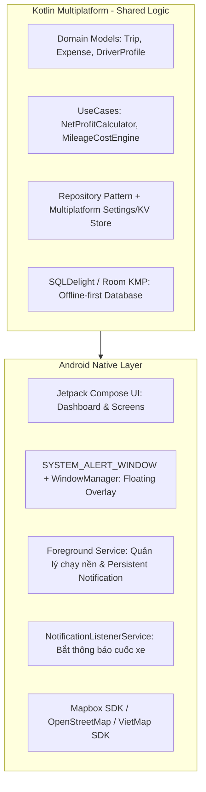

# TÀI LIỆU ĐẶC TẢ DỰ ÁN (PROJECT SPECIFICATION)
# BÁC TÀI (BACTAI) - MULTI-APP DRIVER COMPANION

---

## 1. TỔNG QUAN DỰ ÁN & QUY MÔ THỊ TRƯỜNG

* **Tên ứng dụng:** **Bác Tài (BacTai)**
  * *Tên hiển thị App Launcher:* **Bác Tài**
  * *Tên đầy đủ CH Play / App Store (Chuẩn SEO):* **Bác Tài - Trợ Lý Cuốc Xe, Lãi Ròng & Tiện Ích Đường Phố**
  * *Package Name (KMM/Android):* `vn.bactai.app`
* **Sứ mệnh:** Người bạn đồng hành độc lập bảo vệ túi tiền, tối ưu hóa lợi nhuận ròng và hỗ trợ an sinh đường phố cho đội ngũ tài xế công nghệ tại Việt Nam.
* **Quy mô thị trường (Market Size):**
  * **TAM (Toàn thị trường):** ~1,8 - 2,0 triệu tài xế xe 2 bánh & 4 bánh tại Việt Nam (Grab, Be, Xanh SM, ShopeeFood, Lalamove, Ahamove).
  * **SAM (Thị trường mục tiêu):** ~1,2 triệu tài xế chạy full-time hoặc bán thời gian chuyên nghiệp tập trung tại các đô thị loại 1 (Hà Nội, TP.HCM, Đà Nẵng, Bình Dương, Đồng Nai).
  * **SOM (Mục tiêu 12 tháng đầu):** 50.000 - 100.000 Active Users (chiếm ~5-8% tài xế đô thị lớn).
* **Đặc thù tệp người dùng:**
  * 95%+ sử dụng thiết bị Android tầm trung/giá rẻ (Xiaomi/Redmi, Realme, Oppo, Samsung Galaxy A-series).
  * 60–70% chạy song song 2-3 nền tảng (multi-app) hoặc kết hợp nhận khách vẫy/chở hàng ngoài luồng.
  * Thao tác điện thoại chủ yếu dưới nắng gắt, đeo găng tay, thời gian tương tác với màn hình chỉ từ **2 đến 5 giây** khi đang lái xe hoặc dừng đèn đỏ.

---

## 2. NỖI ĐAU THỰC TẾ CỦA TÀI XẾ (PAIN POINTS)

1. **"Ảo tưởng doanh thu" – Mù mờ về lãi ròng:**
   * Thu nhập hiển thị trên app chỉ là doanh thu gộp (Gross). Sau khi trừ 25–32% chiết khấu sàn + thuế TNCN, tiền xăng, cơm nước và đặc biệt là chi phí hao mòn ẩn (dầu nhớt, lốp, nhông sên dĩa, phanh), tiền thực mang về nhà thường bị hao hụt 40–50% mà tài xế không nhận ra.
2. **Áp lực đánh giá cuốc xe trong 5 giây:**
   * Mỗi khi nổ cuốc, tài xế chỉ có 5–10 giây để đưa ra quyết định nhận/hủy. Việc tự nhẩm xem đơn vị giá `VNĐ/km` có đủ bù tiền xăng và khấu hao hay không (đặc biệt là các cuốc xa trung tâm, nguy cơ "chạy rỗng" về) gây căng thẳng cực độ.
3. **Khan hiếm thông tin tiện ích đường phố an toàn:**
   * Tìm nhà vệ sinh công cộng (WC) miễn phí có chỗ đỗ xe an toàn (không sợ mất đồ/mũ/điện thoại).
   * Tìm quán cơm bụi bình dân giá rẻ (25k-30k) có trà đá miễn phí, chỗ ngồi mát nghỉ trưa.
   * Cứu hộ khẩn cấp: Tiệm vá xe/sửa xe đêm uy tín, tránh "đinh tặc" và nạn "chặt chém".
4. **Tranh chấp hủy đơn / Boom hàng:**
   * Khách đặt đơn giao đồ ăn hoặc đi xe nhưng hủy ngang, không liên lạc được. Thủ tục gửi khiếu nại bồi hoàn cho hãng xe phức tạp, yêu cầu chụp màn hình lịch sử cuộc gọi, ảnh bằng chứng vị trí GPS tại hiện trường theo đúng mốc thời gian.

---

## 3. HẠN CHẾ CỦA CÁC GIẢI PHÁP HIỆN CÓ TRÊN THỊ TRƯỜNG

| Tiêu chí | Ứng dụng Quản lý Chi tiêu (Money Lover, Sổ Bán Hàng...) | Google Maps / Bản đồ số | Nhóm Mạng Xã Hội (Facebook, Zalo) |
| :--- | :--- | :--- | :--- |
| **Bối cảnh thao tác** | Phải mở app, gõ từng ký tự, quá rườm rà; không dùng được khi đang cầm lái ngoài đường. | Chỉ dẫn đường đi chung, không có lớp dữ liệu chuyên biệt cho giới tài xế (WC miễn phí, quán cơm có chỗ đậu xe, điểm ngập lụt tức thì). | Tra cứu thủ công, trôi bài viết nhanh, không định vị tức thì theo bán kính xung quanh vị trí thực tế của tài xế. |
| **Tính toán cuốc xe** | Không có cơ chế nổi (Overlay) tính toán nhanh VNĐ/km trên nền ứng dụng khác. | Không liên quan đến thu chi cuốc xe. | Chỉ có kinh nghiệm truyền miệng, không có công cụ tự động hóa. |
| **Khấu hao xe cộ** | Chỉ hạch toán tiền mặt/chuyển khoản, không tính khấu hao hao mòn máy móc theo từng dòng xe cụ thể. | Không hỗ trợ. | Không hỗ trợ. |

---

## 4. BỘ TÍNH NĂNG ĐỘT PHÁ CỐT LÕI (VALUE PROPOSITIONS)

### 4.1. Bong bóng nổi "Chấm điểm cuốc xe" & Ghi chép 1-chạm (Floating Assistant)
* **Giao diện nổi đa nhiệm:** Nút bong bóng siêu nhẹ (tương tự Messenger Chat Head) đè trên nền Grab/Be/Xanh SM. Tự động mờ (opacity 30-40%) khi không chạm để tránh che khuất bản đồ dẫn đường.
* **Bộ đo tỷ suất VNĐ/km tức thì:**
  * 🟢 **Màu Xanh (> 6.500đ/km):** Cuốc tốt, đảm bảo có lãi sau trừ chi phí vận hành.
  * 🟡 **Màu Vàng (4.500đ – 6.500đ/km):** Cuốc trung bình, nên cân nhắc vị trí trả khách có tiện bắt đơn quay đầu không.
  * 🔴 **Màu Đỏ (< 4.500đ/km):** Cuốc "bào xe", cảnh báo nguy cơ lỗ tiền xăng/hao mòn.
* **Ghi nhận 1-chạm (trong 2 giây):** Bấm nhanh nút nổi để cộng/trừ các khoản phát sinh ngoài luồng: `[+30k Khách vẫy]`, `[+10k Tip]`, `[-60k Đổ xăng]`, `[-30k Ăn trưa]`.

### 4.2. Bảng điều khiển "Lãi Ròng & Khấu Hao Xe"
* **Hồ sơ phương tiện cá nhân:** Tùy biến theo từng dòng xe (Wave Alpha, Sirius, Winner X, Exciter, hoặc xe điện VinFast Feliz/Evo).
* **Công thức tự động:** Tính toán chi phí tiêu hao nhiên liệu/điện năng (Lít/100km hoặc kWh/100km) + Chi phí trích lập bảo dưỡng định kỳ (dầu nhớt, lốp, lọc gió, nhông sên dĩa ~ 200 - 350đ/km).
* **Tiến trình mục tiêu ngày (Daily Target):** Hiển thị trực quan: *"Hôm nay bạn cần thêm 85.000đ lãi sạch để đạt chỉ tiêu 450.000đ mang về nhà"*.

### 4.3. Bản đồ Sinh tồn & Mạng lưới Tương trợ Đồng nghiệp (Crowdsourced POI & P2P Signal)
* **Lớp bản đồ tiện ích (POI Overlay):** Không cạnh tranh dẫn đường với Google Maps, tập trung hiển thị các điểm thiết yếu trong bán kính 3–5km:
  * 🚻 **WC Bác Tài:** Nhà vệ sinh công cộng/cây xăng/TTTM miễn phí, có chỗ để xe an toàn.
  * 🍚 **Trạm nạp năng lượng:** Quán cơm bình dân giá rẻ, trà đá vỉa hè miễn phí, bóng râm nghỉ trưa.
  * 🔧 **Cứu hộ vá xe đêm:** Điểm sửa xe uy tín, niêm yết giá rõ ràng, chống "đinh tặc".
* **Giao tiếp tương trợ 1-chạm (Thay vì phòng chat gây xao nhãng):**
  * 🚨 **Tín hiệu SOS Cứu hộ (Bán kính 2km):** Khi thủng lốp/hết xăng/hỏng bugi đêm muộn, tài xế bấm `[SOS Cứu Hộ]`. Hệ thống phát thông báo tới các bác tài bật app gần nhất để ghé trợ giúp nhau.
  * 🌊 **Cảnh báo tức thời (Live Pins):** Ghim 1-chạm đoạn đường ngập sâu chết máy, điểm tắc nghẽn hoặc rào chắn (tự động hết hạn sau 2–3 giờ).
* **Cơ chế xác thực cộng đồng:** Nút bấm nhanh `[Còn hoạt động]` / `[Đã đóng/Không đúng]` + Hệ số uy tín tài xế để loại bỏ spam.

### 4.4. Hộp đen "Bảo vệ Tài xế" (Bằng chứng hoàn đơn Boom)
* Nút bấm khẩn cấp `[Báo Boom Hàng / Khách Hủy]`.
* Tự động tổng hợp và kết xuất 1 file ảnh bằng chứng chuẩn form bồi hoàn cho sàn gồm:
  1. Ảnh chụp màn hình lịch sử cuộc gọi nhỡ với khách.
  2. Dấu mộc thời gian thực (Server Timestamp).
  3. Tọa độ vị trí GPS hiện tại kèm địa chỉ thực tế.

---

## 5. ĐỊNH HƯỚNG CÔNG NGHỆ (TECH STACK): NATIVE & KMM

Dự án chọn định hướng **Kotlin Multiplatform (KMM)** kết hợp **Android Native** nhằm đảm bảo hiệu năng tối đa trên thiết bị cấu hình thấp, đồng thời tái sử dụng logic khi mở rộng sang iOS:

### Chi tiết kiến trúc kỹ thuật:
1. **Shared KMM Module (Kotlin Multiplatform):**
   * **Domain & Business Logic:** Thuật toán tính lãi ròng, công thức tiêu hao nhiên liệu, khấu hao phương tiện theo dòng xe, công thức tính điểm cuốc xe (VNĐ/km).
   * **Database:** `SQLDelight` (hoặc Room KMP) đảm bảo hoạt động **Offline-First**, phản hồi tức thì mà không cần mạng internet.
   * **Network & Serialization:** `Ktor Client` + `kotlinx.serialization` để đồng bộ dữ liệu nhẹ nhất có thể.
2. **Android Native Target (Giai đoạn cốt lõi):**
   * **UI Framework:** **Jetpack Compose** cho màn hình chính hiện đại, mượt mà và tiêu tốn ít bộ nhớ.
   * **Floating Overlay:** Sử dụng quyền `SYSTEM_ALERT_WINDOW` vẽ trực tiếp qua `WindowManager`. Tạo bong bóng tùy biến kéo thả mượt mà, hỗ trợ chế độ tiết kiệm pin.
   * **Đọc dữ liệu an toàn:** Sử dụng `NotificationListenerService` đọc thông báo biến động đơn mới/thanh toán. **Tuyệt đối không dùng AccessibilityService tự động bấm nhận cuốc** để tránh việc tài xế bị hãng xe khóa tài khoản hoặc bị Google Play từ chối phê duyệt.
   * **Chạy nền bền bỉ (Keep-Alive):** Triển khai `Foreground Service` với thông báo ghim tĩnh trên thanh trạng thái (Status Bar) hiển thị số liệu lãi ròng cập nhật theo thời gian thực.
   * **Bản đồ tối ưu chi phí:** Sử dụng **MapLibre / Mapbox SDK** hoặc **OpenStreetMap (OSMDroid)** kết hợp thuật toán **GeoHash** để chỉ nạp POI trong bán kính 3km, tiết kiệm 90% băng thông và dung lượng pin.

---

## 6. PHÂN TÍCH LỢI ÍCH CỐT LÕI MANG LẠI Ở GIAI ĐOẠN MVP (MVP VALUE & IMPACT)

Ở giai đoạn MVP, ứng dụng **hoàn toàn phi thương mại (100% miễn phí)**, tập trung giải quyết triệt để bài toán tạo giá trị thật và xây dựng lòng tin tuyệt đối với tài xế trước khi nghĩ đến việc tạo doanh thu.

### 6.1. Lợi ích Trực tiếp cho Tài xế (Driver Benefits)

1. **Bảo vệ thu nhập thực tế (Chống chạy lỗ xăng & khấu hao rỗng):**
   * **Định lượng rõ ràng từng km:** Thay vì chạy theo cảm tính hoặc bị "cuốn" theo số tiền hiển thị trên app, tài xế nhìn thấy ngay con số thực nhận `VNĐ/km` trước khi bấm nhận cuốc.
   * **Tránh các cuốc "bào xe":** Giúp tài xế chủ động từ chối hoặc cân nhắc kỹ các chuyến đi xa ngoại thành giá rẻ mà không có đơn quay đầu (tiết kiệm trung bình **50.000đ – 100.000đ tiền xăng chạy rỗng/ngày**).
   * **Quản trị dòng tiền minh bạch:** Nắm rõ chính xác số tiền lãi sạch thực sự mang về nhà sau khi đã trừ tiền xăng thực tế và trích lập quỹ bảo dưỡng xe (dầu nhớt, lốp xe, nhông sên dĩa).

2. **Tiết kiệm thời gian & Tăng cường an toàn lái xe:**
   * **Thao tác 1-chạm không xao nhãng:** Nút bong bóng nổi phản hồi trong 2 giây giúp tài xế ghi chép cuốc khách ngoài hoặc tiền tip mà không cần chuyển qua lại giữa các ứng dụng khi đang dừng đèn đỏ hay đang điều khiển phương tiện.
   * **Giảm căng thẳng tinh thần:** Không còn phải vừa lái xe vừa nhẩm tính toán doanh thu hay lo lắng bị thiếu chỉ tiêu ngày.

3. **Cải thiện điều kiện sinh hoạt đường phố & Tương trợ khẩn cấp:**
   * **Giải quyết nhu cầu thiết yếu nhanh chóng:** Dễ dàng tìm được điểm đi vệ sinh (WC) miễn phí an toàn, điểm phát trà đá, quán cơm bình dân đúng giá và chỗ đỗ xe có bóng mát để nghỉ ngơi giữa trưa nắng gay gắt.
   * **Mạng lưới cứu hộ đồng nghiệp:** Bấm nút SOS nhận trợ giúp vá xe, mượn đồ nghề khi gặp sự cố đêm muộn từ anh em tài xế lân cận.
   * **An tâm chạy đêm:** Giảm nỗi sợ dính "đinh tặc" hay bị thợ sửa xe lạ chặt chém nhờ danh sách cứu hộ uy tín đã được xác thực.

4. **Bảo vệ quyền lợi khi gặp rủi ro (Chống mất tiền oan đơn Boom):**
   * Khi gặp khách không nhận hàng hoặc hủy ngang, tính năng tạo ảnh bằng chứng (Timestamp + GPS + Cuộc gọi nhỡ) giúp tài xế hoàn tất hồ sơ khiếu nại bồi hoàn với hãng xe chỉ trong **1 phút**, giảm tỷ lệ bị hãng từ chối đền bù do thiếu chứng cứ.

---

### 6.2. Lợi ích cho Sản phẩm & Đội ngũ Phát triển (Product & Growth Flywheel)

1. **Xóa bỏ hoàn toàn rào cản tiếp cận (Zero CAC - Không tốn chi phí Marketing):**
   * Ứng dụng miễn phí, thiết thực, tên gọi **Bác Tài** gần gũi sẽ nhanh chóng được chia sẻ tự nhiên trong các hội quán trà đá, các nhóm Facebook/Zalo/TikTok của giới tài xế.
   * Định vị thương hiệu vững chắc: "Ứng dụng của anh em Bác Tài", đối trọng với cảm giác bị nền tảng gọi xe bóc lột hay tăng chiết khấu.

2. **Thu thập dữ liệu thực tế và hoàn thiện mô hình (Data Flywheel):**
   * **Dữ liệu tiêu hao nhiên liệu & chi phí bảo dưỡng thực tế:** Thu thập mẫu số lớn từ hàng ngàn tài xế theo từng dòng xe phổ thông để hiệu chỉnh thuật toán tính toán ngày càng chính xác.
   * **Cơ sở dữ liệu bản đồ tiện ích (POI) ngày càng giàu có:** Cộng đồng tự đóng góp, tự xác thực và đào thải các điểm dữ liệu cũ/sai lệch, tạo nên một bản đồ đường phố chuyên biệt mà Google Maps không có được.

3. **Thước đo thành công giai đoạn MVP (Success Metrics):**
   * **Retention Rate (Giữ chân):** Tỷ lệ tài xế mở bong bóng nổi và duy trì sử dụng sau 7 ngày (D7) và 30 ngày (D30) đạt > 40%.
   * **Tần suất tương tác (Engagement):** Trung bình mỗi tài xế tương tác với Bong bóng nổi từ 8–15 lần/ngày làm việc.
   * **Đóng góp cộng đồng:** Tối thiểu 500+ điểm POI (WC, cơm bụi, tiệm vá xe) được xác thực tại khu vực thử nghiệm ban đầu (Hà Nội hoặc TP.HCM).
