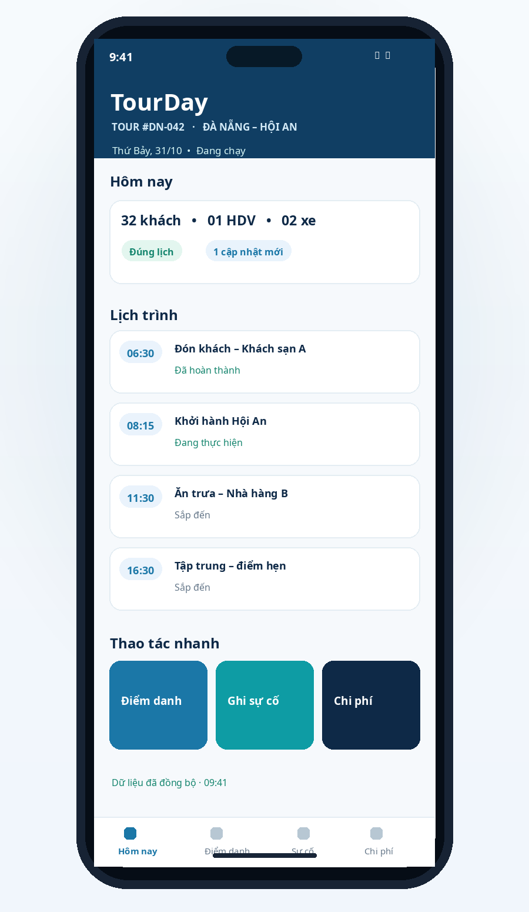
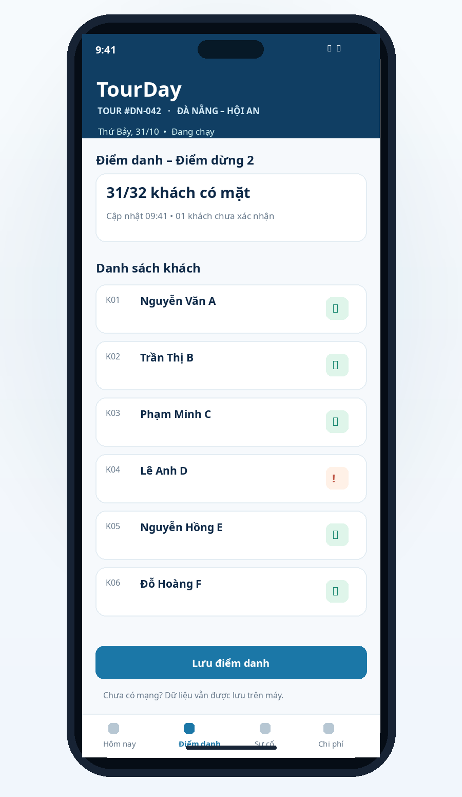
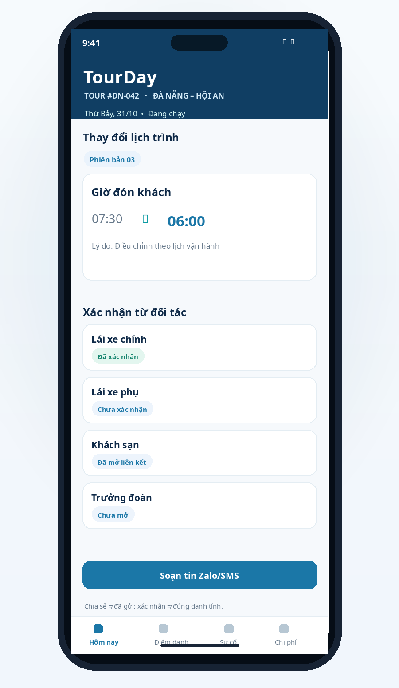
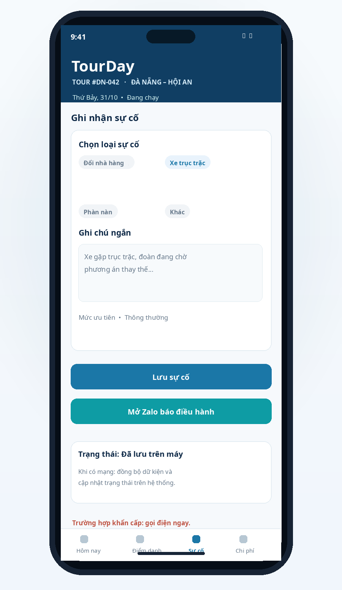
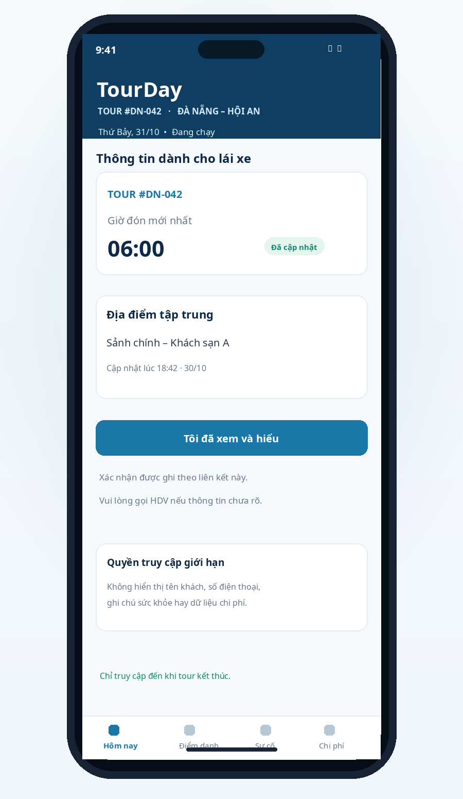

# PROJECT CONCEPT • ANDROID FIELD OPERATIONS • TOUR EXECUTION
# TOURDAY
### Nhật ký điều hành tour trên một màn hình
> **Một tour → Một nguồn thông tin → Mọi thay đổi có dấu vết**

| Định vị sản phẩm: Ứng dụng Android dành cho hướng dẫn viên; đối tác mở liên kết web theo vai trò, không cần cài app. Tập trung vào lịch trình, điểm danh, thay đổi, sự cố và dữ liệu báo cáo theo mã tour. |
| :--- |

- **Đơn vị định hướng:** Khối Kinh doanh và Vận hành Du lịch – Khách sạn, VSF
- **Pilot giả định:** Đà Nẵng – Hội An | đoàn 15–45 khách | 8–12 HDV
- **Phiên bản đề xuất:** 2.0 • **Ngày:** 30/10/2026
- **Phạm vi:** MVP/pilot có điều kiện trong 8 tuần; chưa phải phê duyệt triển khai

---

## Mục lục
1. [Tóm tắt điều hành và quyết định đề xuất](#1-tóm-tắt-điều-hành-và-quyết-định-đề-xuất)
2. [Bài toán, người dùng và giả thuyết kiểm chứng](#2-bài-toán-người-dùng-và-giả-thuyết-kiểm-chứng)
3. [Định vị, phạm vi và khác biệt sản phẩm](#3-định-vị-phạm-vi-và-khác-biệt-sản-phẩm)
4. [Trải nghiệm và luồng nghiệp vụ](#4-trải-nghiệm-và-luồng-nghiệp-vụ)
5. [Chức năng P0/P1/P2 và cắt giảm phạm vi](#5-chức-năng-p0p1p2-và-cắt-giảm-phạm-vi)
6. [Dữ liệu đầu vào, cấu trúc và chất lượng](#6-dữ-liệu-đầu-vào-cấu-trúc-và-chất-lượng)
7. [Cập nhật lịch, liên kết và xác nhận](#7-cập-nhật-lịch-liên-kết-và-xác-nhận)
8. [Kiến trúc kỹ thuật và đồng bộ offline](#8-kiến-trúc-kỹ-thuật-và-đồng-bộ-offline)
9. [Vai trò của AI và phương án không dùng AI](#9-vai-trò-của-ai-và-phương-án-không-dùng-ai)
10. [Giá trị kinh doanh và quy trình vận hành](#10-giá-trị-kinh-doanh-và-quy-trình-vận-hành)
11. [Chi phí dự kiến và kiểm soát ngân sách](#11-chi-phí-dự-kiến-và-kiểm-soát-ngân-sách)
12. [An toàn thông tin, quyền riêng tư, pháp lý](#12-an-toàn-thông-tin-quyền-riêng-tư-pháp-lý)
13. [Rủi ro, phụ thuộc và biện pháp giảm thiểu](#13-rủi-ro-phụ-thuộc-và-biện-pháp-giảm-thiểu)
14. [Kế hoạch triển khai 8 tuần và nhân sự](#14-kế-hoạch-triển-khai-8-tuần-và-nhân-sự)
15. [KPI, kiểm chứng giá trị và Go/No-Go](#15-kpi-kiểm-chứng-giá-trị-và-gono-go)
16. [Những quyết định cần chốt trước khi xây](#16-những-quyết-định-cần-chốt-trước-khi-xây)
- [Phụ lục A. Thuật ngữ và từ viết tắt](#phụ-lục-a-thuật-ngữ-và-từ-viết-tắt)
- [Phụ lục B. Nguồn tham khảo chính thức](#phụ-lục-b-nguồn-tham-khảo-chính-thức)
- [Phụ lục C. Minh họa giao diện đề xuất](#phụ-lục-c-minh-họa-giao-diện-đề-xuất)
- [Phụ lục D. Các tình huống nghiệm thu trọng yếu](#phụ-lục-d-các-tình-huống-nghiệm-thu-trọng-yếu)

> **Cách đọc tài liệu:** Các mục tiêu, số liệu pilot, ngân sách và quyết định công nghệ là giả định để lập kế hoạch; chưa phải dữ liệu thực tế được VSF xác nhận. Các điều kiện pháp lý cần được chuyên trách kiểm tra trước khi dùng dữ liệu thật.

---

## 1. Tóm tắt điều hành và quyết định đề xuất
**TourDay** là ứng dụng Android hỗ trợ hướng dẫn viên thực thi tour đoàn bằng một màn hình ưu tiên công việc trong ngày. Thay vì phân tán giữa tờ điều hành Excel, Zalo, ảnh hóa đơn, ghi chú giấy và các cuộc gọi, mỗi tour có một mã định danh, lịch sử thao tác và báo cáo tập trung.

| Nội dung | Phương án đề xuất |
| :--- | :--- |
| **Định vị** | Guide-first tour operations: công cụ hỗ trợ thực thi, không phải hệ thống đặt tour hoặc ERP toàn diện. |
| **Người dùng chính** | HDV tour đoàn 15–45 khách; điều hành là vai trò phối hợp tối thiểu; lái xe, khách sạn, trưởng đoàn chỉ xem web theo vai trò. |
| **Nền tảng** | Flutter Android app cài đặt trực tiếp; Flutter Web hoặc web tối giản cho trang đối tác; Android là ưu tiên pilot. |
| **Pilot** | Đà Nẵng – Hội An; 8–12 HDV, mục tiêu 20–30 tour; có đầu mối điều hành và kế toán. |
| **P0** | Hôm nay, import mẫu Excel, điểm danh theo tên, thay đổi có xác nhận, sự cố, chi phí số tiền, báo cáo CSV tối giản; liên kết đối tác giới hạn quyền. |
| **AI** | Không bắt buộc trong P0. OCR hóa đơn trên thiết bị là P1, có bước người dùng xác nhận. |
| **Điều kiện** | Có chủ sở hữu nghiệp vụ, template Excel chốt, dữ liệu hợp lệ và thử nghiệm được luồng phát hành/xác nhận. |

### Khuyến nghị đầu tư
> Cho phép 1 tuần discovery + technical spike để kiểm chứng Excel, quyền dữ liệu, liên kết có token và phương án gửi tin trước khi cam kết toàn bộ 8 tuần. Không đo lợi ích khi chưa có baseline.

**Ba giả thuyết quan trọng nhất:**
1. HDV biết ngay thiếu ai, nội dung nào đổi và sự cố nào chưa được xử lý, không cần rà nhiều kênh.
2. Điều hành phân biệt được dữ liệu đã cập nhật với hành vi người nhận đã xác nhận, giúp giảm việc gọi hỏi lại.
3. Ghi chép gắn mã tour tạo ra báo cáo cùng ngày và đối chiếu chi phí ít công hơn cách hiện tại.

---

## 2. Bài toán, người dùng và giả thuyết kiểm chứng

### 2.1. Tình huống xuất phát
18:30 thứ Sáu, tour 32 khách. Điều hành đổi giờ đón sáng hôm sau sớm 1,5 giờ. HDV đang ở chợ đêm phải liên hệ lái xe chính, lái xe phụ, khách sạn và trưởng đoàn. Một người không đọc tin, nhưng không ai biết. Sáng hôm sau việc đón khách sai giờ phát sinh cuộc gọi và chậm trễ. Cuối ngày HDV nhớ lại sự cố, chứng từ nằm rải rác nên báo cáo và đối chiếu chậm.

### 2.2. Nhu cầu cốt lõi (Jobs-to-be-Done)
> Khi đang chạy một tour đoàn và lịch trình có thể thay đổi, tôi muốn biết chính xác lịch mới nhất, ai đã được thông báo, ai còn thiếu và các sự cố/chi phí đã ghi, để hoàn thành tour an toàn và báo cáo đúng ngày.

### 2.3. Vai trò và bối cảnh sử dụng
| Vai trò | Nhu cầu | Hàm ý thiết kế |
| :--- | :--- | :--- |
| **HDV** | Xem một ngày, điểm danh, ghi sự cố nhanh khi đang di chuyển. | Ba hành động nhanh, chữ ≥16sp, thao tác một tay, lưu khi mất mạng. |
| **Điều hành** | Biết phiên bản lịch, xác nhận và tình trạng sự cố. | Trang quản trị tối giản, lịch sử thay đổi và trạng thái chưa xác nhận. |
| **Lái xe/khách sạn/trưởng đoàn** | Chỉ cần những thông tin liên quan đến vai trò. | Liên kết theo vai trò, không xem danh sách khách, chi phí hoặc sự cố nhạy cảm. |
| **Kế toán/quản lý** | Nhận báo cáo thống nhất theo mã tour. | CSV/Excel khớp template đã chốt, có thời gian chốt và người duyệt. |

### 2.4. Giả thuyết
- **H1:** Điểm danh theo tên giúp xác định khách vắng nhanh và ít sai sót hơn đếm tổng số.
- **H2:** Những thay đổi quan trọng được xác nhận theo phiên bản rõ ràng, giảm số cuộc gọi làm rõ.
- **H3:** Báo cáo đơn giản được gửi trong ngày với ít nhập liệu lại.
- **H4:** HDV sẵn sàng dùng app nếu mất không quá vài thao tác ở mỗi điểm dừng.

---

## 3. Định vị, phạm vi và khác biệt sản phẩm

### 3.1. Nguyên tắc thiết kế
- **One-day-first:** màn “Hôm nay” là trung tâm, không mở một dashboard dài để tìm tour.
- **Guide-first:** dùng được khi một tay, dưới nắng và đường truyền không ổn định.
- **Single source of truth:** tour có mã và phiên bản lịch được phê duyệt.
- **Event-based:** đổi lịch, điểm danh và sự cố có dấu thời gian, người ghi và lịch sử bất biến.
- **No false delivery claims:** chia sẻ tin, mở link và xác nhận là các hành vi khác nhau.
- **Human fallback:** khẩn cấp gọi điện; app hỗ trợ phối hợp chứ không thay quy trình an toàn.
- **Minimum sensitive data:** trang đối tác chỉ hiển thị những thông tin họ cần.

### 3.2. So sánh giải pháp hiện tại
| Giải pháp | Điểm mạnh | Khoảng trống TourDay thử giải quyết |
| :--- | :--- | :--- |
| **Excel / mẫu in** | Quen thuộc; dữ liệu chuẩn có sẵn. | Không thuận tiện thao tác và xác nhận thay đổi tại hiện trường. |
| **Zalo / SMS** | Phổ biến, chi phí thấp. | Tin quan trọng trôi; không có phiên bản tour và trạng thái công việc chung. |
| **Google Sheets** | Hợp tác tốt ở bảng dữ liệu. | Thiếu UX chuyên biệt, điểm danh tại điểm dừng và phân quyền web đối tác. |
| **Nền tảng DMC/PMS** | Quản trị sản phẩm và đặt dịch vụ rộng. | Không mặc nhiên tối ưu cho HDV khi chạy tour nhỏ trong pilot. |
| **TourDay** | Lịch, điểm danh, sự cố, chi phí theo mã tour. | Chỉ thực sự khác biệt nếu cải thiện đo được thời gian/độ chính xác. |

### 3.3. Ngoài phạm vi
Không thay Zalo bằng hệ thống nhắn tin độc quyền; không tự đặt vé/thanh toán; không bảo đảm SMS/Zalo được gửi nếu người dùng chỉ mở màn chia sẻ; không theo dõi GPS nền liên tục; không lưu căn cước/hộ chiếu, hồ sơ y tế; không xây ứng dụng riêng cho mọi đối tác trong MVP.

---

## 4. Trải nghiệm và luồng nghiệp vụ

### 4.1. Đầu ngày — khởi tạo tour
1. Điều hành chốt tờ tour theo template Excel/CSV; gán mã tour, ngày, nhân sự, điểm dừng và danh sách khách tối thiểu.
2. HDV đăng nhập, tải tour đã phân công; kiểm tra số khách, lịch trình, phiên bản và dấu đồng bộ.
3. Hệ thống tạo tối đa bốn liên kết theo vai trò: lái xe chính, lái xe phụ, khách sạn và trưởng đoàn; chỉ kích hoạt các vai có nhu cầu thực tế.
4. HDV chủ động chia sẻ tin qua Zalo/SMS hoặc gọi điện. Hệ thống ghi “đã chuẩn bị/đã chia sẻ thủ công”, không nhận là đã gửi thành công nếu không có bằng chứng.

### 4.2. Trong ngày — ba hành động cốt lõi
| Hành động | Luồng | Cách xử lý ngoại lệ |
| :--- | :--- | :--- |
| **Điểm danh** | Mở điểm dừng → chọn tên có mặt/vắng → chốt phiên. | Không ghi “đủ” chỉ vì đếm đúng số; đánh dấu chưa rõ, bổ sung khi xác minh. |
| **Thay đổi lịch** | Điều hành/HDV có quyền cập nhật → tăng phiên bản → phát hành → thông báo. | Thông tin chưa đồng bộ đánh dấu pending; bản mới nhất rõ ràng; cần gọi khi chưa xác nhận. |
| **Sự cố** | Chọn loại → ghi chú ngắn → mức ưu tiên → lưu → điều hành được thông báo. | Sự cố khẩn cấp gọi hotline trước, ghi lại sau; không đưa ghi chú riêng tư vào public link. |

### 4.3. Cuối ngày — chốt và báo cáo
1. HDV rà những điểm danh, thay đổi, sự cố và chi phí đã nhập; app hiển thị phần chưa đầy đủ.
2. HDV xác nhận chốt ngày; hệ thống sinh báo cáo dữ kiện theo template CSV/Excel đã chốt.
3. Báo cáo được gửi qua kênh chính thức do VSF quyết định; kế toán vẫn tiếp nhận chứng từ giấy nếu có quy định.

> **Nguyên tắc nghiệp vụ:** “Báo cáo chính thức” chỉ được công nhận sau khi điều hành và kế toán ký xác nhận quy trình. Trước đó TourDay là công cụ ghi nhận bổ sung; không tự động loại bỏ giấy tờ hiện có.

---

## 5. Chức năng P0/P1/P2 và cắt giảm phạm vi

| Ưu tiên | Chức năng | Tiêu chí nghiệm thu tối thiểu |
| :--- | :--- | :--- |
| **P0** | Android app + đăng nhập | Gán vai trò HDV/điều hành; không truy cập tour không được phân công. |
| **P0** | Nhập mẫu Excel/CSV | Parser kiểm tra lỗi, báo dòng sai, gắn phiên bản template. |
| **P0** | Màn Hôm nay | Lịch đã duyệt, số khách, mã tour, trạng thái đồng bộ và nút nhanh. |
| **P0** | Điểm danh | Nhiều phiên điểm danh, biết thiếu ai, timestamp, sửa có lý do. |
| **P0** | Thay đổi có phiên bản | Thay đổi lưu lịch sử, không ghi đè im lặng; trạng thái xác nhận tách biệt. |
| **P0** | Liên kết đối tác giới hạn | Vai trò riêng, hết hạn/thu hồi; web chỉ thông tin tối thiểu; 4 vai khi đủ điều kiện kỹ thuật. |
| **P0** | Sự cố | Nhóm loại, mô tả tối thiểu, ưu tiên, gửi kênh điều hành sau đồng bộ. |
| **P0** | Chi phí số tiền | Số tiền, danh mục, mã tour, mã chứng từ tùy chọn; chưa cần ảnh. |
| **P0** | Báo cáo tối giản | CSV/Excel từ các dữ kiện thật; chỉ số tổng hợp có thể đối chiếu. |
| **P0** | Bảo mật & QA | Quy tắc phân quyền, thử offline, ghi trùng, link hết hạn, lỗi template. |
| **P1** | Ảnh hóa đơn + OCR | Lưu ảnh qua dịch vụ được duyệt; OCR trên thiết bị; HDV xác nhận tổng tiền. |
| **P1** | Trang điều hành mở rộng | Xem nhiều tour, lọc sự cố và nhắc follow-up. |
| **P1** | Ghi chú giọng nói | Chỉ kích hoạt khi có quy trình quyền riêng tư phù hợp. |
| **P2** | Đồng bộ hệ thống nội bộ | Tích hợp ERP/PMS/tài chính khi có API và chủ sở hữu dữ liệu. |
| **P2** | Ứng dụng đối tác | Chỉ khi nhu cầu và khối lượng vận hành chứng minh được. |

### 5.1. Nguyên tắc cắt giảm khi trễ
Giữ bằng mọi giá: lịch hôm nay có phiên bản, điểm danh, ghi sự cố, xuất dữ liệu và kiểm soát truy cập. Thứ tự hoãn: ảnh hóa đơn → OCR/AI → dashboard quản trị nâng cao → vai liên kết chưa sử dụng trong pilot. Không cắt kiểm thử bảo mật hay lịch sử thay đổi để lấy thêm tính năng.

### 5.2. Quy tắc “tối thiểu còn có giá trị”
> **P0 lõi:** Một tour được nhập, HDV nhìn thấy bản chính xác, điểm danh và ghi sự cố được khi mất mạng, điều hành thấy thay đổi khi đồng bộ, và cuối ngày xuất CSV đúng mã tour. Nếu liên kết đối tác chưa đạt tiêu chí an toàn, pilot dùng chia sẻ Zalo/SMS thông thường nhưng phải đánh dấu giới hạn.

---

## 6. Dữ liệu đầu vào, cấu trúc và chất lượng

### 6.1. Mẫu Excel/CSV chuẩn hóa
| Sheet | Trường tối thiểu | Quy tắc |
| :--- | :--- | :--- |
| **Tours** | tour_id, tour_date, guide_id, status | Một tour_id duy nhất; ngày theo múi giờ VN; không trùng tour. |
| **Stops** | stop_id, tour_id, time, location, contact_role | Đúng thứ tự; phiên bản khi sửa giờ/điểm. |
| **Guests** | guest_code, display_name, tour_id | Dùng mã nội bộ, không CMND/hộ chiếu; chỉ HDV/điều hành có quyền. |
| **Contacts** | role, phone (nếu cần), tour_id | Chỉ vai cần biết; chính sách xóa theo retention. |
| **Finance** | tour_id, advance_amount (nếu có) | Kế toán xác nhận cách ghi, loại tiền tệ, dấu thập phân. |

### 6.2. Mô hình dữ liệu khởi điểm
| Đối tượng | Khóa / dữ liệu trọng yếu | Ghi chú kỹ thuật |
| :--- | :--- | :--- |
| **Tour** | tourId, version, assignedGuide, approvedAt | Lịch trình được phiên bản hóa; không ghi đè im lặng. |
| **AttendanceSession** | sessionId, stopId, checkedIds, unknownIds | Không chỉ lưu headcount; hỗ trợ so sánh nhiều điểm. |
| **Incident** | incidentId, eventAt, severity, status | Dấu thời gian máy và server; dữ liệu nhạy cảm phân quyền. |
| **Expense** | expenseId, amountVnd, category, docRef | Đồng nhất tiền VND dạng số nguyên. |
| **PartnerLink** | linkId, role, scope, expiresAt, revokedAt | Token bí mật chỉ lưu hash ở backend, quyền tối thiểu. |
| **AckEvent** | ackId, linkId, tourVersion, actionAt | Xác nhận qua token chưa chứng minh danh tính thật. |
| **AuditEvent** | eventId, actor, action, deviceAt, serverAt | Sự kiện bổ sung, hạn chế sửa/xóa ngoài quy trình. |

---

## 7. Cập nhật lịch, liên kết và xác nhận

### 7.1. Phân biệt trạng thái
| Trạng thái | Ý nghĩa chính xác | Không được suy diễn |
| :--- | :--- | :--- |
| **Đã cập nhật** | Bản thay đổi đã ghi thành công trên hệ thống trung tâm. | Không có nghĩa đối tác biết. |
| **Đã mở chia sẻ** | HDV mở giao diện Zalo/SMS hoặc sao chép tin. | Không có nghĩa người nhận đã nhận được. |
| **Đã mở liên kết** | Link được truy cập với token hợp lệ. | Không xác minh danh tính người mở. |
| **Đã xác nhận** | Người giữ link bấm xác nhận cho phiên bản cụ thể. | Không mặc nhiên chứng minh đã thực hiện. |
| **Quá hạn** | Chưa có xác nhận sau thời gian đã chốt. | Cần gọi/nhắn lại; không tự kết luận mất sóng. |

### 7.2. Chu trình phiên bản và quyền thay đổi
- Một thay đổi phải gắn `tourId`, `changeId`, `version`, `changedFields`, `old/new`, `actor`, `reason` và thời điểm.
- Lịch có giá trị là phiên bản được cấp quyền phát hành; thay đổi đồng bộ từ HDV khi offline ở trạng thái “chờ xác minh” nếu xung đột.
- Mỗi liên kết đối tác chỉ đọc phiên bản mới nhất thuộc phạm vi vai trò; nếu link hết hạn/thu hồi, từ chối truy cập.
- Xác nhận phải gắn phiên bản. Khi có version mới, xác nhận version cũ không được tính đã xác nhận version mới.

---

## 8. Kiến trúc kỹ thuật và đồng bộ offline

| Lớp | Trách nhiệm | Đề xuất |
| :--- | :--- | :--- |
| **Mobile** | Hôm nay, điểm danh, sự cố, tài chính và xuất báo cáo. | Flutter Android, state management; local SQLite có mã hóa phù hợp, Android Keystore để giữ khóa. |
| **Backend data** | Tour, danh sách nội bộ, thay đổi, ACK và audit. | Cloud Firestore + Firebase Auth + Security Rules theo vai trò. |
| **Token gateway** | Tạo, xác minh, thu hồi link; đọc projection và ghi ACK. | Cloud Functions/HTTPS với cơ chế rate limit; Blaze và chi phí cần phê duyệt. |
| **Partner web** | 4 vai chỉ xem thông tin tối thiểu trong trình duyệt. | Flutter Web hoặc web nhẹ, Firebase Hosting; không có quyền tìm toàn bộ tour. |
| **Offline queue** | Ghi sự kiện khi mất mạng, thử lại và tránh gửi trùng. | Local outbox, eventId cố định, trạng thái pending/synced/conflict. |
| **Export** | Xuất CSV/Excel theo mã tour. | Tạo trên máy HDV; tài liệu được ký duyệt theo quy trình nghiệp vụ. |
| **Media P1** | Ảnh hóa đơn hoặc ảnh sự cố đã duyệt. | Cloud Storage có kiểm soát; không nhét ảnh vào Firestore document. |

---

## 9. Vai trò của AI và phương án không dùng AI
TourDay là sản phẩm tăng hiệu quả quy trình, không cần LLM để hoạt động. Đưa AI vào P0 sẽ làm tăng rủi ro vì dữ liệu tour và khách cần kiểm soát chặt. Lựa chọn hợp lý là AI hỗ trợ tác vụ đơn lẻ trong P1 sau khi pilot đã xác minh giá trị lõi.

| Tính năng | Vai trò AI | Quy tắc an toàn |
| :--- | :--- | :--- |
| **P0 báo cáo cuối ngày** | Không dùng AI; tổng hợp bằng template từ dữ liệu cấu trúc. | Không bịa sự kiện, có số liệu và mã tour truy vết. |
| **P1 OCR hóa đơn** | ML Kit OCR trên thiết bị đọc chữ và đề xuất tổng tiền. | HDV sửa/xác nhận; lưu giá trị được xác nhận, không để AI tự quyết chi phí. |
| **P1 tóm tắt báo cáo** | LLM được phép viết lại văn phong từ các sự kiện đã duyệt. | Không sinh người, số tiền, nguyên nhân hay kết luận không có dữ liệu. |
| **P2 phát hiện bất thường** | Rule-based trước, AI sau nếu đủ dữ liệu. | Có kiểm thử sai sót và tránh tự động quy trách nhiệm. |

> **Nguyên tắc:** AI đề xuất, HDV/điều hành kiểm soát. App phải hoạt động đầy đủ khi AI không sẵn sàng.

---

## 10. Giá trị kinh doanh và quy trình vận hành

### 10.1. Giá trị theo vai trò
| Nhóm | Giá trị kỳ vọng | Chứng cứ cần đo |
| :--- | :--- | :--- |
| **HDV** | Ít thao tác tìm tin, ghi chép và tổng hợp hơn. | Thời gian điểm danh, mức sử dụng, khảo sát cuối pilot. |
| **Điều hành** | Biết thay đổi nào đã xác nhận; phát hiện việc chưa xử lý. | Tỷ lệ ACK hợp lệ, số cuộc gọi kiểm tra, thời gian nhận sự cố. |
| **Kế toán** | Dữ liệu chi phí có cấu trúc và mã tour. | Phút đối chiếu/tour, số dòng cần chỉnh sửa. |
| **Quản lý** | Có timeline để truy vết sự cố và đánh giá quy trình. | Tỷ lệ báo cáo đúng ngày, chất lượng hồ sơ sự cố. |

---

## 11. Chi phí dự kiến và kiểm soát ngân sách
Mức pilot 20–30 tour và 8–12 HDV có thể nằm trong hạn mức không tính phí của một số dịch vụ Firebase, nhưng không đồng nghĩa hóa đơn bằng 0. Tài khoản billing phải được phê duyệt nếu dùng Cloud Functions/Storage.

- **Auth/Firestore/Hosting:** Có phần hạn mức miễn phí, vượt mức tính theo sử dụng.
- **Cloud Functions:** Yêu cầu Blaze; có quota không tính phí nhưng vẫn cần billing.
- **Ảnh hóa đơn/sự cố (P1):** Cloud Storage và egress có thể phát sinh phí.

---

## 12. An toàn thông tin, quyền riêng tư, pháp lý

### 12.1. Nguyên tắc tối thiểu hóa dữ liệu
Danh sách khách, số điện thoại đối tác, thông tin công việc và ghi chú tour có thể là dữ liệu cá nhân. Không lưu CMND/hộ chiếu trong P0. Link công khai theo vai trò không chứa tên khách, lịch trình toàn đoàn, ghi chú bệnh lý, số điện thoại riêng hay khoản tiền.

### 12.2. Phân quyền và quản lý token
- HDV chỉ truy cập tour được phân công; điều hành được phân quyền theo đoàn/đơn vị; kế toán chỉ nhận dữ liệu cần để đối chiếu.
- Token của liên kết lưu ở phía người dùng/URL, server chỉ giữ hash; token random đủ mạnh, có thời hạn, có thể thu hồi.

### 12.3. Pháp lý tại Việt Nam
Luật Bảo vệ dữ liệu cá nhân số 91/2025/QH15 và Nghị định 356/2025/NĐ-CP có hiệu lực từ 01/01/2026. Pháp chế VSF phải xác nhận trước khi tải dữ liệu cá nhân thật.

---

## 13. Rủi ro, phụ thuộc và biện pháp giảm thiểu

| Rủi ro | Mức | Biện pháp giảm thiểu |
| :--- | :--- | :--- |
| **Không có quyền dùng file tour thật** | Rất cao | Dữ liệu giả lập và 3–5 file đã ẩn danh; chỉ chạy pilot thật sau phê duyệt. |
| **Gửi Zalo/SMS không bảo đảm** | Cao | Ghi trạng thái chia sẻ chính xác, fallback gọi điện, không tự ghi “đã gửi”. |
| **Link bị chuyển tiếp** | Cao | Giới hạn thông tin; token ngẫu nhiên, TTL/thu hồi và xác nhận không đại diện danh tính. |
| **Lỗi offline hoặc đồng bộ trùng** | Cao | Local outbox + eventId idempotent + test ngắt mạng nhiều thời điểm. |
| **Lệch template Excel** | Cao | Freeze schema tuần 1; kiểm tra trước import và báo lỗi theo dòng. |

---

## 14. Kế hoạch triển khai 8 tuần và nhân sự

### 14.1. Roadmap có cổng quyết định
| Tuần | Công việc | Đầu ra / cổng quyết định |
| :--- | :--- | :--- |
| **1 – Discovery** | Phỏng vấn 5–8 HDV, 2 điều hành, 1 kế toán; đo baseline; chốt template/nguồn dữ liệu; rà bảo mật. | Gate 1: có chủ sở hữu nghiệp vụ, template, mẫu tour hợp lệ và quyền dùng dữ liệu. |
| **2 – UX & nền** | Prototype UI, Flutter Android, Auth, import parser, local cache, tour demo. | App mở được trên máy thật, nhập file sai có thông báo rõ. |
| **3 – Luồng cốt lõi** | Hôm nay, điểm danh nhiều điểm, sự cố và bộ dữ liệu sự kiện. | Demo offline điểm danh, đồng bộ không sinh sự kiện trùng. |
| **4 – Thay đổi & link** | Versioning, gateway token, web theo vai, ack, thu hồi/hết hạn, chia sẻ tin. | Gate 2: kiểm thử an ninh link, role, version, mất mạng. |
| **5 – Báo cáo** | Chi phí không ảnh; CSV/Excel theo template; export và đối chiếu; bug fix. | Chạy khép kín 3 tour nội bộ bằng dữ liệu giả/được phép. |
| **6 – Pilot A** | Huấn luyện 8–12 HDV; pilot từng đợt; đối chiếu dữ kiện với quy trình cũ. | Không có lỗi P0 nghiêm trọng; giữ kênh gọi điện dự phòng. |
| **7 – Pilot B** | Mở rộng mục tiêu 20–30 tour nếu có; đo KPI, phỏng vấn, hỗ trợ. | Số liệu có mẫu đủ dùng. |
| **8 – Đánh giá** | Audit chất lượng, phân tích trước–sau, chi phí, bảo mật; quyết định. | Go / Iterate / No-Go dựa trên ngưỡng và điều kiện nền tảng. |

---

## 15. KPI, kiểm chứng giá trị và Go/No-Go

### 15.1. Định nghĩa chỉ số và mục tiêu giả định
| KPI | Cách đo | Ngưỡng thử nghiệm |
| :--- | :--- | :--- |
| **Báo cáo trong ngày** | Số tour chốt/gửi trước 23:59 theo ngày tour ÷ tổng tour hợp lệ. | ≥90%, ghi rõ phương án gửi được chấp nhận. |
| **Thời gian điểm danh** | Từ mở phiên đến xác định đủ/thiếu ai và chốt. | Trung vị <60 giây trong tour 15–45 khách. |
| **Tốc độ xác nhận thay đổi** | Từ khi bản cập nhật được phát hành đến ACK trên phiên bản mới. | Mục tiêu ≥80% ACK trong 15 phút ở các vai pilot có tham gia. |
| **Sự cố tới điều hành** | Từ lúc sự cố được HDV ghi nhận đến điều hành ACK. | Trung vị giảm ≥30% so với baseline. |
| **Đối chiếu chi phí** | Phút/tour từ khi nhận dữ liệu đến khi kế toán đối chiếu xong. | Trung vị giảm ≥25% so với baseline. |

---

## 16. Những quyết định cần chốt trước khi xây
| Quyết định | Khuyến nghị hiện tại | Người cần xác nhận |
| :--- | :--- | :--- |
| **Dữ liệu & template** | Một file Excel chuẩn, version có quy tắc; 3–5 file kiểm thử được phép. | Điều hành/BA/IT |
| **Cấp quyền lịch** | Bản phát hành cần có vai trò duyệt; HDV đề xuất khi offline. | Điều hành VSF |
| **Liên kết đối tác** | Bốn vai tối đa, thông tin tối thiểu, token hết hạn/thu hồi. | Vận hành/IT/bảo mật |
| **Kênh thông báo** | Zalo/SMS chia sẻ thủ công; gọi điện khi khẩn cấp hoặc quá hạn. | HDV/điều hành |
| **Báo cáo chính thức** | Chốt template và quyền duyệt, xác định bản giấy/ảnh/CSV. | Kế toán/pháp chế |
| **Cloud/Billing** | Blaze + Cloud Functions sau duyệt hoặc backend thay thế đã kiểm định. | IT/tài chính |
| **Thời hạn lưu** | Theo loại dữ liệu và mục đích, không mặc định 48 giờ. | Pháp chế/VSF |
| **KPI** | Chốt baseline, mẫu tối thiểu, định nghĩa ACK và phương án đo. | BA/Product owner |

---

## Phụ lục A. Thuật ngữ và từ viết tắt
| Thuật ngữ | Giải nghĩa |
| :--- | :--- |
| **HDV** | Hướng dẫn viên du lịch. |
| **MVP** | Minimum Viable Product – phiên bản nhỏ nhất đủ để kiểm chứng giá trị. |
| **Offline-first** | Thiết kế cho phép thao tác trước khi có Internet, đồng bộ sau khi khôi phục mạng. |
| **Idempotency** | Gửi lại cùng một thao tác không tạo thêm bản ghi trùng. |
| **ACK** | Acknowledgement – sự kiện xác nhận một thông tin theo phiên bản cụ thể. |
| **Token / capability link** | Chuỗi bí mật trao quyền truy cập giới hạn cho người giữ liên kết. |

---

## Phụ lục B. Nguồn tham khảo chính thức
- **[1] Firebase Pricing:** https://firebase.google.com/pricing
- **[2] Cloud Firestore quotas:** https://firebase.google.com/docs/firestore/quotas
- **[3] Firestore offline data:** https://firebase.google.com/docs/firestore/manage-data/enable-offline
- **[4] Cloud Firestore Security Rules:** https://firebase.google.com/docs/firestore/security/rules-conditions
- **[5] Firebase budget & caps:** https://firebase.google.com/docs/projects/billing/budget-alerts
- **[6] Luật số 91/2025/QH15:** https://bocongan.gov.vn/chinh-sach-phap-luat/co-so-du-lieu-van-ban/luat-bao-ve-du-lieu-ca-nhan-1753688803
- **[7] Nghị định 356/2025/NĐ-CP:** https://chinhphu.vn/?classid=0&docid=216387&pageid=27160

---

## Phụ lục C. Minh họa giao diện đề xuất
Các màn hình dưới đây là concept dành cho ứng dụng Android và liên kết web theo vai trò, nhằm trình bày trải nghiệm sản phẩm. Chúng không phải giao diện đã lập trình, dữ liệu tour và nhân sự đều là minh họa giả lập.

### Màn hình 1 – Hôm nay
Một tour, thời gian cập nhật, lịch trình và ba hành động chính; phù hợp thao tác một tay.

### Màn hình 2 – Điểm danh
Danh sách theo mã khách; biết ngay ai chưa xác nhận thay vì chỉ đếm tổng số.

### Màn hình 3 – Cập nhật và trạng thái
Đổi giờ có phiên bản; trạng thái của từng đối tác không bị nhầm thành “đã gửi thành công”.

### Màn hình 4 – Sự cố
Ghi loại, ghi chú, ưu tiên; bản ghi lưu cục bộ trước, chia sẻ Zalo là bước riêng.

### Màn hình 5 – Trang web theo vai trò
Lái xe chỉ xem giờ và điểm đón mới nhất, có xác nhận theo token, không thấy danh sách khách.

---

## Phụ lục D. Các tình huống nghiệm thu trọng yếu
| Mã | Kịch bản | Kết quả kỳ vọng |
| :--- | :--- | :--- |
| **T01** | HDV mất mạng sau điểm danh, khởi động lại app. | Phiên và người vắng còn trên máy; online lại chỉ sinh một sự kiện. |
| **T02** | Điều hành đổi giờ trong lúc HDV có thay đổi cũ chưa đồng bộ. | Không âm thầm ghi đè; hiển thị pending/conflict và bản duyệt. |
| **T03** | Lái xe mở link v2 sau khi tour đã là v3. | Trang hiện thông tin mới nhất; ACK v2 không được tính cho v3. |
| **T04** | Link khách sạn bị gửi nhầm cho người khác. | Không lộ roster, chi phí, ghi chú nội bộ, số điện thoại khách. |
| **T05** | Thu hồi link, người nhận thử mở lại. | API từ chối, thông báo link hết hiệu lực. |
| **T06** | HDV mở share sheet Zalo nhưng đóng không gửi. | App không tự ghi đã gửi thành công; chỉ ghi hành vi mở chia sẻ. |
| **T07** | File Excel trùng guest_code hoặc sai định dạng giờ. | Import bị chặn hoặc hiển thị chính xác dòng cần sửa. |
| **T08** | HDV chưa đồng bộ nhưng chọn chốt ngày. | Bản báo cáo gắn nhãn nháp, yêu cầu đồng bộ trước chốt chính thức. |
| **T09** | Truy cập API tour không thuộc quyền HDV. | Từ chối với log bảo mật tối thiểu. |
| **T10** | Có sự cố khẩn cấp; app offline. | Hiển thị hotline/gọi điện; nội dung sự cố lưu máy để bổ sung sau. |
